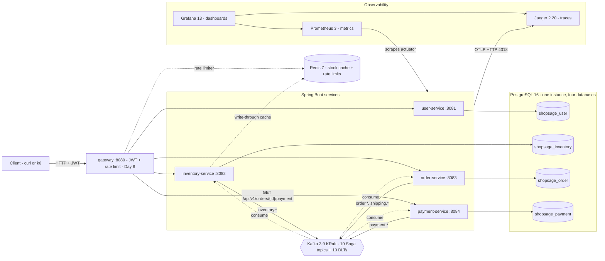
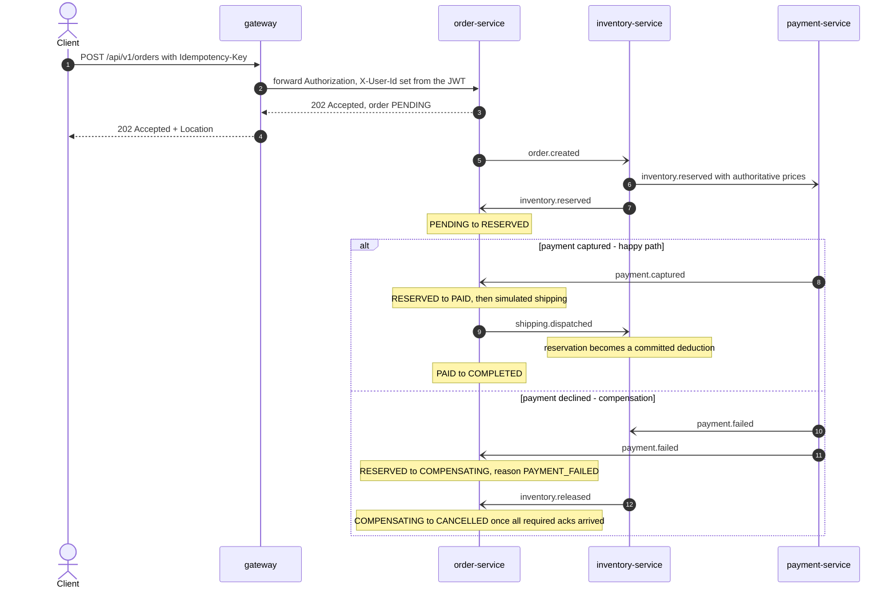

# ShopSage Micro Platform

A 4-service e-commerce backend (in progress, Day 1 of 11) that will demonstrate Saga choreography over Kafka, a transactional outbox, Toxiproxy chaos tests and Prometheus/Grafana/Jaeger observability — with every headline number backed by a dated run in `docs/experiment_log.md`, not slideware.

<!-- TODO(Day 9): replace the CI placeholder badge with the GitHub Actions workflow badge once the repo has a remote. -->
[](#roadmap)
[](LICENSE)
[](https://openjdk.org/projects/jdk/17/)
[](docs/adr/0005-spring-boot-3.2-pin-and-cve-overrides.md)

**Status (Day 1, 2026-10-18):** scaffolding only. The infrastructure stack runs, the four services boot with
health/metrics/info endpoints, and each has a passing Testcontainers smoke test (`./mvnw verify`). No business endpoints exist yet — see the [roadmap](#roadmap).

## Headline numbers

> **TODO(Day 7): nothing in the "Measured" column has been measured yet.** The targets are goals, not results.
> Every number that lands here links to a dated row in [`docs/experiment_log.md`](docs/experiment_log.md).

| Metric | Target | Measured | Scenario | Environment | Evidence |
|---|---|---|---|---|---|
| Throughput through the gateway | 5,000 req/s | pending (Day 7) | spike hold window, k6 scenario mix | pending (Day 7) | pending (Day 7) |
| Latency p99 at that throughput | ≤ 180 ms | pending (Day 7) | spike hold window, k6 scenario mix | pending (Day 7) | pending (Day 7) |
| Saga rollback success under 15 % failures | ≥ 99.5 % | pending (Day 7) | chaos, failure knobs + Toxiproxy | pending (Day 7) | pending (Day 7) |

**How these are measured.**
*Spike* means ramp to 5,000 req/s, then hold for N minutes (k6 `constant-arrival-rate` executor); QPS and p99 are
measured on the hold window only — a ramp has no steady state.
*QPS* is successful requests per second through the gateway for the k6 scenario mix.
*p99* is the 99th percentile of k6 `http_req_duration` over the same window.
*Rollback success* is, among orders in which any Saga stage failed or timed out (injected or natural), the percentage that
reached `CANCELLED` with all required compensation acks within 60 s (for a timeout these are `inventory.released` and
the payment ack `payment.refunded`, outcome `REFUNDED` or `VOIDED`). It is also reported over compensation-required Sagas
only — orders where stock was or may have been reserved (`PAYMENT_FAILED`, `SHIPPING_FAILED`, `TIMEOUT` in `PENDING` or
`RESERVED`); `OUT_OF_STOCK` cancellations are reported as their own count, because they need no compensation and cannot
fail the metric. "15 % service failure" means 15 % business-level
failures injected at each Saga stage plus Toxiproxy network toxics on the Postgres, Redis and Kafka data paths; the exact
mix, VM size and trace sampling rate are recorded per run. With all three knobs at 0.15 and independent, about 38.6 % of
Sagas fail (1 − 0.85³) before any Toxiproxy-induced failures; about 15 points of that are out-of-stock rejects.

## Architecture



Each service owns its database (no cross-service joins, [ADR-0001](docs/adr/0001-database-per-service-on-one-postgres-instance.md)).
Services never call each other synchronously during a Saga: every event carries the `orderId`, `userId` and money/lines
the next participant needs ([ADR-0003](docs/adr/0003-messaging-contract-and-idempotency.md)). user-service is HTTP-only:
it neither produces nor consumes Kafka events. Until the gateway lands on
Day 6, clients call the services directly on 8081-8084. Full design: [`docs/design.md`](docs/design.md).

## Order Saga

Choreography, not orchestration ([ADR-0002](docs/adr/0002-saga-choreography-and-order-state-machine.md)). Every arrow between
order-, inventory- and payment-service below is a Kafka record keyed by `orderId`, written through a transactional outbox (Day 4)
and consumed idempotently.



Timeouts (a 30 s order sweeper plus reservation self-expiry), late events and the full compensation matrix are in
[`docs/design.md` §4](docs/design.md#4-saga-choreography).

## Quick start

**Prerequisites**

- Docker with Compose v2 (Docker Desktop, OrbStack or colima). VM sizing: infrastructure only — 4 CPU / 6 GiB;
  services in containers plus load tests — 6 CPU / 8 GiB or more (`colima start --cpu 6 --memory 8`).
- JDK 17 (only for building and running services on the host). Maven is not required: the repo ships `./mvnw` (Maven 3.9.16).
- `unzip` (preinstalled on macOS; on minimal Linux run `sudo apt-get install -y unzip` or `sudo dnf install -y unzip`).
  Without it `./mvnw` downloads the `.tar.gz` distribution, which fails the pinned `.zip` SHA-256 check with "your Maven
  distribution might be compromised".
- `scripts/dev-env.sh` finds JDK 17 and, for non-default Docker contexts, exports the `DOCKER_HOST` Testcontainers
  needs, plus `TESTCONTAINERS_DOCKER_SOCKET_OVERRIDE=/var/run/docker.sock` when that socket is forwarded from a VM
  under `$HOME` (colima, Docker Desktop, OrbStack; not for Linux rootless Docker or Podman).

```bash
# 1. Infrastructure: Postgres, Redis, Kafka (+ topic init), Prometheus, Grafana, Jaeger
./scripts/dev-up.sh                 # --tools adds kafka-ui, --pull refreshes images, --help for all flags

# 2. Build and test (integration tests need Docker; add -DskipITs to run unit tests only)
source scripts/dev-env.sh
./mvnw -q -DskipTests install       # once, and again after changing common/
./mvnw verify

# 3a. Run one service on the host (Prometheus scrapes host.docker.internal by default) ...
./mvnw -pl services/order-service spring-boot:run

# 3b. ... or build and run all four services as containers (Prometheus switches to the docker targets)
./scripts/dev-up.sh --with-apps --build

# 4. Stop everything (-v also deletes Postgres/Kafka/Grafana/Prometheus data, after confirmation)
./scripts/dev-down.sh
```

| What | URL / address | Credentials |
|---|---|---|
| Grafana | http://localhost:3000 | `admin` / `$GRAFANA_ADMIN_PASSWORD` (default `admin`); anonymous Viewer enabled |
| Prometheus | http://localhost:9090 | none |
| Jaeger UI | http://localhost:16686 | none |
| Kafka (host clients) | `localhost:9092` (advertised as `$KAFKA_ADVERTISED_HOST:9092`) | PLAINTEXT |
| PostgreSQL | `jdbc:postgresql://localhost:5432/shopsage_<svc>` for `user`, `inventory`, `order`, `payment` | `shopsage_<svc>` / `shopsage_<svc>`; admin `shopsage` / `shopsage` |
| Redis | `localhost:6379` | none |
| kafka-ui (`--tools`) | http://localhost:8089 | none |
| A service | http://localhost:8083/actuator/health (8081-8084) | none |

## Services and ports

All published ports bind to `${BIND_HOST:-127.0.0.1}` — Docker-published ports bypass host firewalls, so set
`BIND_HOST=0.0.0.0` only on a trusted network, and then also set `KAFKA_ADVERTISED_HOST` to the VM's IP or DNS name:
Kafka clients reconnect to the advertised listener, which defaults to `localhost`.

| Component | Host port | Notes |
|---|---|---|
| gateway | 8080 | Day 6 — Spring Cloud Gateway at `services/gateway` |
| user-service | 8081 | registration, login, JWT issuance (Day 2); HTTP only, no Kafka producer or consumer |
| inventory-service | 8082 | catalog, prices, stock reservations, Redis cache (Day 3) |
| order-service | 8083 | order lifecycle (`POST /api/v1/orders` on Day 4), Saga state machine, simulated shipping (Day 5) |
| payment-service | 8084 | mock payment provider, capture / refund (Day 5) |
| postgres | 5432 | one instance, databases `shopsage_user`, `shopsage_inventory`, `shopsage_order`, `shopsage_payment` |
| redis | 6379 | cache only, no persistence |
| kafka | 9092 | host listener, advertised as `${KAFKA_ADVERTISED_HOST:-localhost}:9092`; containers use `kafka:29092`; controller 9093 is not published |
| prometheus | 9090 | |
| grafana | 3000 | |
| jaeger | 16686 | UI; OTLP gRPC 4317, OTLP HTTP 4318 |
| kafka-ui | 8089 | profile `tools` |
| toxiproxy | 8474 | Day 7, profile `chaos`; proxies 15432 → postgres, 16379 → redis, 39092 → Kafka `CHAOS` listener |

## Project layout

```
shopsage-micro-platform/
├── pom.xml                       # Maven parent: aggregator + dependencyManagement + pluginManagement
├── mvnw  mvnw.cmd  .mvn/wrapper/maven-wrapper.properties
├── common/                       # shared library jar (com.shopsage.common): event envelope, topics, ProblemDetail handler
├── services/                     # every deployable Spring Boot application
│   ├── user-service/             # com.shopsage.user       :8081
│   ├── inventory-service/        # com.shopsage.inventory  :8082
│   ├── order-service/            # com.shopsage.order      :8083
│   ├── payment-service/          # com.shopsage.payment    :8084
│   └── gateway/                  # Day 6 — Spring Cloud Gateway :8080 (not created yet)
├── configs/                      # all non-Java configuration
│   ├── postgres/init/01-create-databases.sh
│   ├── kafka/create-topics.sh
│   ├── prometheus/prometheus.yml
│   ├── prometheus/targets/host.json  docker.json
│   ├── grafana/provisioning/{datasources,dashboards,alerting,plugins}/   # one provisioning YAML each
│   ├── grafana/dashboards/       # Day 8 dashboard JSON (README only so far)
│   └── deploy/                   # Day 10 Helm values: values-minikube.yaml, values-oke.yaml (README only so far)
├── deploy/helm/shopsage/         # Day 10 Helm chart (not created yet)
├── data/                         # raw/ and processed/ are gitignored
│   └── samples/                  # small committed seed data (Day 3 inventory CSV)
├── docs/
│   ├── design.md                 # full technical design
│   ├── api_spec.md               # REST API definition
│   ├── experiment_log.md         # benchmark and chaos results
│   └── adr/                      # 0001 … 0005 architecture decision records
├── tests/                        # system-level tests only
│   ├── load/                     # Day 7 k6 scripts
│   └── chaos/                    # Day 7 Toxiproxy scenarios
├── scripts/
│   ├── dev-up.sh  dev-down.sh    # bring the stack up / down
│   └── dev-env.sh                # source me: JAVA_HOME + Docker/Testcontainers env
├── Dockerfile  .dockerignore     # one multi-stage Dockerfile for every service (ARG SERVICE); see Deployment
├── docker-compose.yml  .env.example
├── .gitignore  .gitattributes  .editorconfig
├── LICENSE
├── plan.md  plan.zh-CN.md       # status, day-by-day plan, optional cloud deployment (English / 简体中文)
├── memory.md  memory.zh-CN.md   # handoff notes: what exists, decisions to keep, how to resume
└── README.md
```

Every service uses the same package structure (controller → service → repository):

```
com.shopsage.<service>
├── <Service>ServiceApplication.java
├── api/          # REST controllers + request/response DTOs (records)
├── service/      # use cases; transaction boundaries
├── domain/       # JPA entities, value objects, enums, domain exceptions
├── repository/   # Spring Data JPA repositories
├── messaging/    # Kafka producers/consumers, outbox relay (Day 4+)
├── mapper/       # MapStruct mappers
└── config/       # @Configuration classes
```

**Mapping to my personal project-layout standard (`code_standard.md`, not part of this repo; originally written for Python/ML repos).** This is how
each of its folders maps onto a Maven monorepo.

| `code_standard.md` | This repo | Why |
|---|---|---|
| `configs/` (`train/`, `deploy/`) | `configs/` (`postgres/`, `kafka/`, `prometheus/`, `grafana/`, `deploy/`) | all non-Java config in one place; `configs/deploy/` keeps its meaning (deployment values, Day 10) |
| `data/raw/`, `data/processed/` (gitignored) | same, gitignored | nothing needs `data/raw` or `data/processed` yet; k6 output goes to the gitignored `tests/load/results/` |
| `data/samples/` | `data/samples/` | small committed seed data |
| `docs/design.md`, `experiment_log.md`, `api_spec.md` | same three files, plus `docs/adr/` | decisions recorded as ADRs |
| `notebooks/` | intentionally omitted | no exploratory analysis in a Java backend |
| `src/` | `common/` and `services/*/`, each with Maven's `src/main` and `src/test` | Maven module convention |
| `tests/` | `tests/load/`, `tests/chaos/` (system level) | unit and integration tests live next to the code in each module's `src/test`, run by Surefire/Failsafe |
| `scripts/` | `scripts/` | dev-up / dev-down / dev-env |
| `requirements.txt`, `setup.py` | `pom.xml` (parent + modules) and `./mvnw` | dependency and build definition |
| `Dockerfile` | root `Dockerfile` with `ARG SERVICE` | one file builds every service image |
| `.gitignore`, `README.md` | same | |

## Tech stack and versions

| Component | Version | Note |
|---|---|---|
| Java / Spring Boot | 17 / 3.2.12 | 3.2 is a fixed requirement; OSS support ended 2024-11, patched via property overrides ([ADR-0005](docs/adr/0005-spring-boot-3.2-pin-and-cve-overrides.md)) |
| Spring Cloud | 2023.0.6 | gateway from Day 6 |
| Spring Data JPA, Flyway | Boot-managed, Flyway 10.22.0 | Flyway 10 for PostgreSQL 16 support |
| Spring Kafka / kafka-clients | Boot-managed / 3.9.2 override | matches the broker |
| MapStruct, Lombok | 1.6.3, 1.18.48 | Lombok allowed but kept to a minimum |
| Testcontainers | 1.21.4 | JUnit 5 |
| Maven | 3.9.16 via wrapper 3.3.4 | |
| PostgreSQL | `postgres:16.15-alpine` | |
| Redis | `redis:7.4.11-alpine` | |
| Kafka | `apache/kafka:3.9.2` | official ASF image, KRaft, no ZooKeeper |
| Jaeger | `jaegertracing/jaeger:2.20.0` | pinned below 2.21: 2.21+ removed the v1 query API that Grafana 13.2's Jaeger datasource still calls |
| Prometheus / Grafana | `prom/prometheus:v3.15.0` / `grafana/grafana:13.2.4` | |
| kafka-ui | `ghcr.io/kafbat/kafka-ui:v1.5.0` | optional, profile `tools` |
| Toxiproxy | `ghcr.io/shopify/toxiproxy:2.13.0` | Day 7 |
| Base images | `eclipse-temurin:17-jdk-noble` (build), `eclipse-temurin:17-jre-noble` (runtime) | multi-arch, see [ADR-0004](docs/adr/0004-multi-arch-images-for-arm-free-tier.md) |

## Roadmap

Day-by-day scope, acceptance criteria and the optional cloud deployment: [plan.md](plan.md)
([简体中文](plan.zh-CN.md)). Handoff notes: [memory.md](memory.md) ([简体中文](memory.zh-CN.md)).

- [x] **Day 1 (2026-10-18)** — Maven monorepo (parent, `common`, four services), Docker Compose infrastructure, Kafka topics, Prometheus/Grafana/Jaeger wiring, Testcontainers smoke tests, design docs and ADRs
- [ ] **Day 2** — user-service: registration, login, JWT issuance, Spring Security
- [ ] **Day 3** — inventory-service: catalog and prices, stock, Redis write-through cache, seed data in `data/samples/`
- [ ] **Day 4** — order-service `POST /api/v1/orders` as the first outbox producer; messaging backbone: transactional outbox + relay, idempotent consumers, retries and dead-letter topics
- [ ] **Day 5** — Saga end to end: order-service state machine and timeout sweeper, payment-service, compensations
- [ ] **Day 6** — `services/gateway`: routing, JWT validation, Redis rate limiting
- [ ] **Day 7** — k6 load tests and Toxiproxy chaos tests; first measured headline numbers
- [ ] **Day 8** — observability: Grafana dashboards, trace sampling preset for load runs, Jaeger tuning
- [ ] **Day 9** — GitHub Actions CI, multi-arch images pushed to GHCR, Trivy scanning, Dependabot
- [ ] **Day 10** — Helm chart in `deploy/helm/shopsage`, minikube; optional Oracle Cloud OKE (ARM), steps in [plan.md §5](plan.md#5-cloud-deployment-plan-optional-follows-the-hosting-plan)
- [ ] **Day 11** — final benchmark and chaos runs, results write-up, trade-offs, demo GIF and 2-minute video

## Benchmarks

TODO(Day 7): k6 scenarios (baseline: constant 1K req/s; spike: ramp to 5,000 req/s, then hold for N minutes with the
k6 `constant-arrival-rate` executor, QPS and p99 measured on the hold window only) and their results, linked to
[`docs/experiment_log.md`](docs/experiment_log.md). Scripts will live in [`tests/load/`](tests/load/README.md).

## Chaos test results

TODO(Day 7): rollback success under 15 % injected failures (failure knobs `PAYMENT_FAILURE_RATE`,
`SHIPPING_FAILURE_RATE`, `INVENTORY_FAILURE_RATE` plus Toxiproxy toxics). Scenarios will live in
[`tests/chaos/`](tests/chaos/README.md).

## Observability

Already wired on Day 1:

- **Metrics**: every service exposes `/actuator/prometheus` with an `application` tag and `http.server.requests`
  histograms. Prometheus scrapes them every 5 s through one file-based job; `PROMETHEUS_TARGETS=host` (default) points it
  at `host.docker.internal:8081-8084` for services started with `./mvnw`, `docker` at the containers (`dev-up.sh` selects it with `--with-apps` or when the app containers are already
  running; an explicit `PROMETHEUS_TARGETS=host` in the shell, or any non-`host` value in `.env`, always wins).
- **Traces**: Micrometer Tracing (OpenTelemetry bridge) exports OTLP over HTTP to Jaeger; Kafka observation is enabled so
  the `traceparent` header follows a Saga across services. Actuator requests are excluded from traces and latency metrics.
- **Logs**: Boot's console format plus `[<traceId>,<spanId>]`, e.g.
  `2026-10-18T18:08:29.048-07:00  INFO 1 --- [order-service] [nio-8083-exec-1] [<traceId>,<spanId>] o.s.web.servlet.DispatcherServlet : ...`.
  `traceId`/`spanId` are MDC fields written by Micrometer Tracing (empty outside a request or consumer span), so a
  trace id from a log line can be pasted into Jaeger search.
- **Grafana**: Prometheus and Jaeger datasources are provisioned.

TODO(Day 8): dashboards (RED metrics per service, Saga outcomes, Kafka consumer lag) and screenshots.

## Deployment

- **Local (primary)**: Docker Compose, as in the quick start. Every measured number in this README will come from this path (recorded in `docs/experiment_log.md`).
  user-service waits only for Postgres and Jaeger; the three Kafka services also wait for the broker and `kafka-init`.
- **Images**: one root `Dockerfile` (`--build-arg SERVICE=<artifactId>`), tagged `shopsage/<service>:local` with
  `pull_policy: never` (never pulled from Docker Hub). The runtime stage runs as uid/gid 1001 over root-owned, read-only
  app files; `JAVA_OPTS` defaults to `-XX:MaxRAMPercentage=60 …` so the heap follows `APP_MEM_LIMIT`; container
  arguments are forwarded to the application (e.g. `docker run --rm shopsage/order-service:local --debug`).
- **Kubernetes**: TODO(Day 10): Helm chart in `deploy/helm/shopsage`, per-environment values in `configs/deploy/`, tested on minikube.
- **Optional cloud**: the same chart on Oracle Cloud's always-free Ampere A1 (ARM) capacity via OKE. That is why every
  image is multi-arch (`linux/amd64` + `linux/arm64`) — [ADR-0004](docs/adr/0004-multi-arch-images-for-arm-free-tier.md).

## Security posture (dev-only)

The local stack is deliberately convenient, not secure: Kafka uses PLAINTEXT listeners, all credentials are dev defaults
from `.env.example`, Grafana allows anonymous Viewer access, and Prometheus exposes its unauthenticated lifecycle
endpoints (`/-/reload` and `/-/quit`). Mitigation: every port is bound to `127.0.0.1` via `BIND_HOST`. The Day 10 Helm values turn
these defaults off for any shared environment.

Services 8081-8084 are published for debugging and can be called directly by any local caller. From Day 2 every
service validates the JWT itself and takes the caller from its subject; the `X-User-Id` header (set by the gateway from
Day 6) is never trusted for authorization, so setting it by hand grants nothing. Until then the services have no business
endpoints, and their actuator endpoints are unauthenticated.

## Trade-offs

Decided on Day 1 (each with an ADR):

- **Choreography over orchestration** — no central coordinator to scale or fail, at the cost of a Saga that is only
  visible through traces and the order state machine ([ADR-0002](docs/adr/0002-saga-choreography-and-order-state-machine.md)).
- **One Postgres instance, four databases** — real isolation (no cross-service joins) at laptop cost; moving to separate
  instances only changes `DB_URL` ([ADR-0001](docs/adr/0001-database-per-service-on-one-postgres-instance.md)).
- **Outbox + idempotent consumers** — at-least-once delivery without distributed transactions, paid for with a relay and
  a dedupe table per service ([ADR-0003](docs/adr/0003-messaging-contract-and-idempotency.md)).
- **Spring Boot 3.2 pinned past EOL** — a fixed requirement, mitigated with patch/minor dependency overrides
  ([ADR-0005](docs/adr/0005-spring-boot-3.2-pin-and-cve-overrides.md)).

TODO(Day 11): trade-offs backed by measurements (partition count vs consumer parallelism, outbox relay latency,
cache hit ratio vs staleness).

## Third-party components and licenses

The infrastructure images are used unmodified as development dependencies and are not redistributed with this code:
Apache Kafka, Prometheus, Jaeger and kafka-ui (Apache-2.0); PostgreSQL (PostgreSQL License); Redis 7.4 (RSALv2 / SSPLv1);
Grafana (AGPLv3); Toxiproxy (MIT, Day 7). Java dependencies are resolved from Maven Central under their own licenses.

## License

[MIT](LICENSE) © 2026 Yi Zhao
