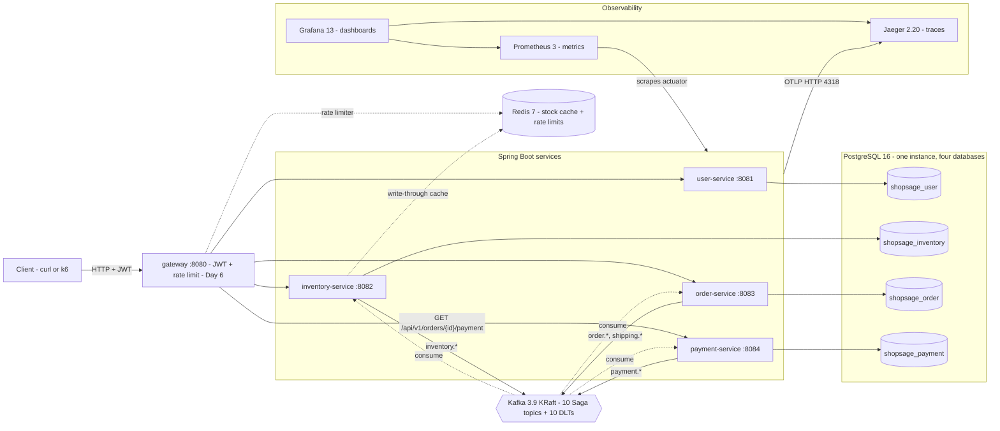
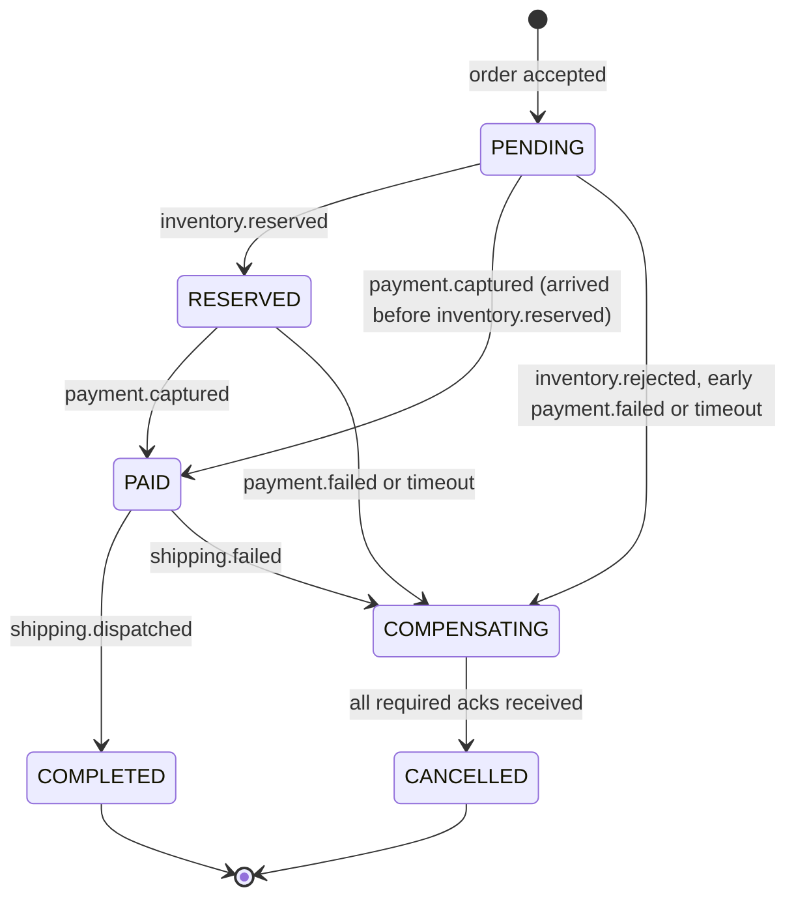

# ShopSage Micro Platform — Technical Design

| | |
|---|---|
| Status | Living document. Day 1 (2026-10-18): scaffolding implemented; sections marked "design" are decided but land on the day named. |
| Owner | Yi Zhao |
| Decisions | [`docs/adr/`](adr/) — ADR-0001 … ADR-0005 |

## Contents

1. [Context and goals](#1-context-and-goals)
2. [Architecture overview](#2-architecture-overview)
3. [Services and responsibilities](#3-services-and-responsibilities)
4. [Saga choreography](#4-saga-choreography)
5. [Messaging contract](#5-messaging-contract)
6. [Data ownership](#6-data-ownership)
7. [Outbox and idempotency](#7-outbox-and-idempotency)
8. [Caching](#8-caching)
9. [API gateway](#9-api-gateway)
10. [Observability](#10-observability)
11. [Configuration conventions](#11-configuration-conventions)
12. [Testing strategy](#12-testing-strategy)
13. [Deployment](#13-deployment)
14. [Repository layout and code_standard.md mapping](#14-repository-layout-and-code_standardmd-mapping)
15. [Versions and upgrade notes](#15-versions-and-upgrade-notes)
16. [Open questions](#16-open-questions)

---

## 1. Context and goals

ShopSage is a deliberately small e-commerce backend (users, inventory, orders, payments) whose purpose is to demonstrate,
with measured evidence, how a distributed order flow behaves under load and under failure.

**Goals**

- A checkout spanning three services that stays consistent without distributed transactions: Saga choreography over
  Kafka, transactional outbox, idempotent consumers.
- Resume targets, to be measured and reported honestly (definitions in §12):
  - **5,000 req/s through the gateway at p99 ≤ 180 ms** for the k6 scenario mix;
  - **≥ 99.5 % Saga rollback success** with 15 % business-level failures injected at each Saga stage plus network
    toxics (definitions in §12).
- Production-shaped operations: every service exposes `/actuator/health`, `/actuator/metrics`, `/actuator/info` and
  `/actuator/prometheus`; all configuration lives in `application.yml` and is overridable by environment variables;
  one trace per Saga across services; logs correlated by `traceId`/`spanId`.
- Clean architecture inside each service: controller → service → repository, MapStruct for mapping, Flyway for schema.

**Non-goals**: any UI, a real payment provider (payments are mocked), multi-region, gRPC, a service mesh.

## 2. Architecture overview



Synchronous traffic only flows client → gateway → one service (the gateway sends `GET /api/v1/orders/{id}/payment` to
payment-service, which owns that data; §9). Everything between services is asynchronous Kafka events, so a slow or
failed participant delays a Saga instead of cascading timeouts back to the client. user-service is HTTP-only: it has
no Kafka producer or consumer.

## 3. Services and responsibilities

| Service | Port | Package | Database | Owns | Lands |
|---|---|---|---|---|---|
| user-service | 8081 | `com.shopsage.user` | `shopsage_user` | accounts, password hashes, JWT issuance; HTTP only, no Kafka producer/consumer | Day 2 |
| inventory-service | 8082 | `com.shopsage.inventory` | `shopsage_inventory` + Redis | catalog, **prices**, stock, reservations | Day 3 |
| order-service | 8083 | `com.shopsage.order` | `shopsage_order` | orders, Saga state machine, timeout sweeper, simulated shipping | Day 4 (`POST`, outbox), Day 5 (Saga) |
| payment-service | 8084 | `com.shopsage.payment` | `shopsage_payment` | payments (mock provider), captures, refunds | Day 5 |
| gateway | 8080 | — | Redis (rate limits) | routing, JWT validation, `X-User-Id` propagation, rate limiting | Day 6 |
| common (library) | — | `com.shopsage.common` | — | event envelope, topic names, RFC 7807 error handling, actuator observation filter | Day 1 |

`common` is intentionally thin: shared *conventions*, never shared domain classes. Consumers parse events into their own
DTOs (§5), so one service's refactor cannot break another's compile.

Package structure, identical in every service:

```
com.shopsage.<service>
├── <Service>ServiceApplication.java   # @SpringBootApplication
├── api/          # REST controllers + request/response DTOs (records)
├── service/      # use cases; transaction boundaries
├── domain/       # JPA entities, value objects, enums, domain exceptions
├── repository/   # Spring Data JPA repositories
├── messaging/    # Kafka producers/consumers, outbox relay (Day 4+)
├── mapper/       # MapStruct mappers (componentModel=spring, constructor injection)
└── config/       # @Configuration classes
```

`common` today: `event.DomainEvent` (envelope record), `event.Topics` (ten topic constants, `DLT_SUFFIX`, `dltOf`, `all`),
`web.GlobalExceptionHandler` (extends `ResponseEntityExceptionHandler`; RFC 7807 `ProblemDetail`), `web.ResourceNotFoundException`
(404), `web.BusinessRuleException` (409), and two auto-configurations (`web.CommonWebAutoConfiguration`,
`observability.ObservabilityAutoConfiguration`). The handler re-throws Spring Security exceptions so the security filter
chain can still answer 401/403 once Day 2 adds it.

## 4. Saga choreography

Decision and alternatives: [ADR-0002](adr/0002-saga-choreography-and-order-state-machine.md). Implementation: Day 5.

### 4.1 Stages

| Stage | Participant | Action | Compensation |
|---|---|---|---|
| 1 reserve | inventory-service | reserve stock at authoritative prices | release reservation |
| 2 capture | payment-service | capture `totalAmountMinor` with the mock provider | refund |
| 3 ship | order-service | simulated shipping with a configurable failure rate | — (last stage) |

### 4.2 Order state machine



`COMPENSATING` and `CANCELLED` carry a reason: `OUT_OF_STOCK`, `PAYMENT_FAILED`, `SHIPPING_FAILED` or `TIMEOUT`.
An order becomes `CANCELLED` **only after every required compensation ack arrived** — `inventory.released` if stock was
(or may have been) reserved, `payment.refunded` if money was captured **or `order.cancelled` was emitted** (a capture
may be in flight, so payment-service always answers `order.cancelled` with `payment.refunded`, outcome `REFUNDED` or
`VOIDED`; §4.4). order-service tracks the two acks separately (`released_ack`, `payment_ack`) and moves to `CANCELLED`
only when every required one has arrived. When no ack is required (out of stock), the `COMPENSATING → CANCELLED` step
happens in the same transaction. This makes `CANCELLED` a promise ("nothing is left held"), which is exactly what the
rollback metric measures.

**Cross-topic order.** `inventory.reserved` and `payment.captured` travel on different topics, and Kafka orders events
only within one topic's partition (§5.2), so order-service may see the capture first. It then goes `PENDING → PAID`.
The order total is taken from whichever of `inventory.reserved.totalAmountMinor` or `payment.captured.amountMinor`/`currency`
arrives first (they are equal by construction: payment captures inventory's total). A later `inventory.reserved` on
`PAID` or `COMPLETED` only fills in `reservationId` and the lines (no state change); on `COMPENSATING` or `CANCELLED`
it is a no-op, because inventory already handles release-before-reserve. For the same reason a `payment.failed` can
arrive while the order is still `PENDING`; it is handled exactly as in `RESERVED` (→ `COMPENSATING(PAYMENT_FAILED)`).

### 4.3 Compensation matrix

| Trigger | Detected by | From state | Compensating events | Acks required before CANCELLED | Final |
|---|---|---|---|---|---|
| `inventory.rejected` | inventory-service | PENDING | none | none | CANCELLED(OUT_OF_STOCK) |
| `payment.failed` | payment-service | RESERVED | inventory consumes `payment.failed` and releases | `inventory.released` | CANCELLED(PAYMENT_FAILED) |
| `shipping.failed` | order-service | PAID | payment refunds, inventory releases (both consume `shipping.failed`) | `payment.refunded` + `inventory.released` | CANCELLED(SHIPPING_FAILED) |
| timeout in PENDING | order-service sweeper | PENDING | `order.cancelled {reason: TIMEOUT}` | `inventory.released` + `payment.refunded` (outcome `REFUNDED` or `VOIDED`) | CANCELLED(TIMEOUT) |
| timeout in RESERVED | order-service sweeper | RESERVED | `order.cancelled {reason: TIMEOUT}` | `inventory.released` + `payment.refunded` (outcome `REFUNDED` or `VOIDED`) | CANCELLED(TIMEOUT) |

### 4.4 Timeouts and late events

- **Sweeper (order-service)**: orders in `PENDING` or `RESERVED` for longer than `SAGA_TIMEOUT_SECONDS` (default 30)
  move to `COMPENSATING(TIMEOUT)` and emit `order.cancelled {orderId, reason: TIMEOUT}`. The move is a conditional
  update on state (`... WHERE id = ? AND state IN ('PENDING', 'RESERVED')`), so the sweeper only cancels orders still
  `PENDING` or `RESERVED` at the moment of the update and cannot race a concurrent `→ PAID` transition. `PAID` is not
  swept: shipping runs inside order-service and cannot hang on another service.
- **inventory-service** releases the reservation on `order.cancelled` and always answers with `inventory.released`
  (empty `lines` when nothing was held) so the order can close. It records the cancellation, so an `order.created` that
  arrives after it is not reserved ("release before reserve" is a no-op). As a backstop for a lost or delayed
  `order.cancelled`, reservations also expire on their own after `SAGA_TIMEOUT_SECONDS + 15` s and emit `inventory.released`.
- **payment-service** always answers `order.cancelled` with `payment.refunded`, mirroring inventory's empty-lines
  `inventory.released`: outcome `REFUNDED` (`amountMinor` = the captured amount) if it had captured, otherwise outcome
  `VOIDED` (`amountMinor` 0), in which case it also records the void so a late `inventory.reserved` is never captured. The ack is
  idempotent and keyed by `orderId`: a repeated `order.cancelled` re-sends the same outcome and never refunds twice.
- **Late capture**: a `payment.captured` for an order in `COMPENSATING` or `CANCELLED` makes order-service re-emit
  `order.cancelled` so payment refunds. In `PENDING` or `RESERVED` it is a normal capture (→ `PAID`); in `PAID` or
  `COMPLETED` it is a duplicate and a no-op. Because the payment ack is required whenever `order.cancelled` was
  emitted, this rule should no longer fire after `CANCELLED`; it stays as defence in depth, and if it does fire the
  Saga counts as a rollback failure in the metric.
- **Duplicates**: duplicate events and duplicate acks are no-ops thanks to idempotent consumers (§7).

### 4.5 Failure scenarios

| Scenario | Expected behaviour |
|---|---|
| Consumer crashes after DB commit, before offset commit | Event redelivered; `processed_events` makes it a no-op. |
| Service crashes after state change, before publishing | The event is in the outbox table in the same transaction; the relay publishes it after restart. |
| Kafka unavailable | Outbox rows accumulate; HTTP `POST /api/v1/orders` still answers 202; Sagas resume when Kafka returns. |
| Poison message | 3 retries with exponential backoff, then `<topic>.DLT` (Day 4); the order times out and is compensated. |
| Participant down for longer than the timeout | Sweeper cancels; reservation self-expiry is the backstop if the cancel cannot be consumed. |
| Out-of-order arrival (`payment.captured` before `inventory.reserved`, on different topics) | Order goes `PENDING → PAID` using the capture amount; the later `inventory.reserved` only fills in reservation data; no refund. |
| Postgres latency or resets (Toxiproxy) | Requests slow or fail fast (Hikari timeouts); Sagas are delayed, not lost. Measured on Day 7. |

## 5. Messaging contract

Decision: [ADR-0003](adr/0003-messaging-contract-and-idempotency.md). Topic names are constants in `com.shopsage.common.event.Topics`.

### 5.1 Topics

| Topic | Producer | Consumers | Meaning |
|---|---|---|---|
| `order.created` | order-service | inventory-service | reserve stock for a new order |
| `order.cancelled` | order-service | inventory-service, payment-service | order timed out or a late capture must be undone: release / refund or void; both consumers always ack |
| `inventory.reserved` | inventory-service | payment-service, order-service | stock held at authoritative prices; payment captures `totalAmountMinor`, order → RESERVED |
| `inventory.rejected` | inventory-service | order-service | out of stock (or injected failure) |
| `inventory.released` | inventory-service | order-service | compensation ack |
| `payment.captured` | payment-service | order-service | order → PAID, then simulated shipping |
| `payment.failed` | payment-service | inventory-service, order-service | release reservation; order → COMPENSATING |
| `payment.refunded` | payment-service | order-service | compensation ack (refund or void) |
| `shipping.dispatched` | order-service | inventory-service | reservation becomes a committed deduction; order → COMPLETED |
| `shipping.failed` | order-service | payment-service, inventory-service | refund and release |

user-service appears nowhere in this table: it neither produces nor consumes events, and has no Kafka client at all.

Each base topic has a dead-letter twin `<topic>.DLT`; `kafka-init` creates all **20 topics** up front with 3 partitions
and replication factor 1 (local). Broker auto-creation is **disabled** so a typo in a topic name fails loudly instead of
silently creating a topic nobody consumes. DLTs have the same partition count as their base topic because Spring Kafka's
`DeadLetterPublishingRecoverer` publishes to the same partition index by default.

### 5.2 Event envelope and wire format

Record value = the JSON text of `DomainEvent`, produced with `StringSerializer`:

```json
{
  "eventId": "6f1c2a0e-6d0b-4a51-9a3e-1b7c0f3c9d21",
  "eventType": "inventory.reserved",
  "schemaVersion": 1,
  "aggregateId": "<orderId>",
  "occurredAt": "2026-10-18T12:00:00Z",
  "payload": {
    "orderId": "<orderId>",
    "userId": "<userId>",
    "reservationId": "<reservationId>",
    "lines": [{ "sku": "SKU-001", "quantity": 2, "unitPriceMinor": 1999 }],
    "totalAmountMinor": 3998,
    "currency": "USD"
  }
}
```

**Money** is always an integer in minor units with an ISO-4217 `currency` next to it (`3998` + `USD` = 39.98 USD),
mapped to `long` in Java; the field name says so (`amountMinor`, `unitPriceMinor`, `totalAmountMinor`). No floating
point and no decimal strings on the wire, so sums are exact and every consumer parses amounts the same way. The REST
API uses the same representation ([api_spec.md](api_spec.md#conventions)).

| Kafka element | Content | Why |
|---|---|---|
| key | `orderId` | all events of one order on one topic land on one partition, so they are consumed in order *per topic* — and only because the relay publishes each aggregate's rows in outbox order (§7). There is no ordering across topics: order-service must accept `inventory.reserved` and `payment.captured` in either order (§4.2) |
| header `eventId` | UUID | dedupe without parsing the body |
| header `eventType` | e.g. `order.created` | routing to the right consumer DTO |
| header `schemaVersion` | integer, starts at 1 | explicit evolution |
| header `traceparent` | W3C trace context | one trace per Saga (§10); deliberately not in the envelope |

Consumers use `ErrorHandlingDeserializer` delegating to `StringDeserializer` and parse by `eventType` into
**consumer-owned DTOs**. There are no Java type headers and no shared producer classes, so services can be refactored and
deployed independently, and a malformed record becomes a handled error instead of a stuck partition. On Day 1 the
convention is `eventType` = topic name; the field exists so a topic can later carry more than one type without a format change.
Evolution rule: additive changes keep `schemaVersion`; a breaking change bumps it and consumers accept N and N-1 during rollout.

### 5.3 Payloads (design; `order.created` on Day 4, the rest on Day 5)

| Event | Payload |
|---|---|
| `order.created` | `{orderId, userId, items[{sku, quantity}]}` — no prices: the client never sends them |
| `inventory.reserved` | `{orderId, userId, reservationId, lines[{sku, quantity, unitPriceMinor}], totalAmountMinor, currency}` |
| `inventory.rejected` | `{orderId, reason}` |
| `inventory.released` | `{orderId, reservationId, lines}` (lines may be empty) |
| `payment.captured` | `{orderId, userId, paymentId, amountMinor, currency}` |
| `payment.failed` | `{orderId, reason}` |
| `payment.refunded` | `{orderId, paymentId?, amountMinor, currency, outcome}` — `outcome` is `REFUNDED` (`amountMinor` = captured amount) or `VOIDED` (no `paymentId`, `amountMinor` 0) |
| `order.cancelled` | `{orderId, reason}` |
| `shipping.dispatched` / `shipping.failed` | `{orderId, ...}` — final fields decided on Day 5 |

**Price authority and context propagation.** inventory-service owns the catalog and prices. The client never sends a
price, and `userId` comes from the subject of the JWT that the service validated itself (§9), never from a request
body or from `X-User-Id`. Every Saga event carries `orderId`, `userId` and the money/lines its consumers need, so no
participant ever calls another synchronously mid-Saga. order-service stores the authoritative total from
`inventory.reserved`, or from `payment.captured` if the capture arrives first (equal by construction, §4.2).

### 5.4 Error handling (Day 4)

`DefaultErrorHandler` with 3 retries and exponential backoff, then `DeadLetterPublishingRecoverer` → `<topic>.DLT`.
Deserialization failures go straight to the DLT (retrying cannot fix bytes). DLT records keep the original headers, so a
dead letter can be traced back to its Saga in Jaeger.

## 6. Data ownership

Decision: [ADR-0001](adr/0001-database-per-service-on-one-postgres-instance.md).

- One `postgres:16.15-alpine` container, four logical databases, one login role each:
  `shopsage_user`, `shopsage_inventory`, `shopsage_order`, `shopsage_payment`. Admin superuser `shopsage`.
- `configs/postgres/init/01-create-databases.sh` runs once on an empty volume: creates each role (password from
  `<X>_DB_PASSWORD`, default = role name) and its database, then `REVOKE CONNECT ... FROM PUBLIC` and grants `CONNECT`
  to the owner only — `shopsage_order` cannot even connect to `shopsage_payment`.
- Separate *databases* rather than schemas: PostgreSQL cannot join across databases, so cross-service joins are
  impossible rather than merely discouraged. Moving a service to its own instance changes only `DB_URL`.
- Schema is owned by Flyway in each service (`classpath:db/migration`, first migration on the service's build day);
  Hibernate runs with `ddl-auto: validate` and `open-in-view: false`; timestamps are stored in UTC.
- Data another service needs travels in events (§5.3), never through its database.

## 7. Outbox and idempotency

Design; implemented on Day 4.

**Transactional outbox.** Every state change and the event describing it are written in one local transaction:

```sql
CREATE TABLE outbox (
    id             uuid PRIMARY KEY,       -- = DomainEvent.eventId
    aggregate_type text        NOT NULL,   -- e.g. 'order'
    aggregate_id   text        NOT NULL,   -- Kafka key (orderId)
    event_type     text        NOT NULL,
    payload        jsonb       NOT NULL,   -- the full DomainEvent envelope
    headers        jsonb       NOT NULL,   -- incl. traceparent captured at write time
    created_at     timestamptz NOT NULL DEFAULT now(),
    published_at   timestamptz             -- NULL until the relay has published it
);
```

**Relay: a single active relay per service.** Each poll first takes `pg_try_advisory_xact_lock(<service-relay-key>)`,
and replicas that do not get it skip the cycle. The holder reads unpublished rows `ORDER BY created_at, id` (`LIMIT n`),
publishes them one after another with the idempotent producer (`acks=all`,
`max.in.flight.requests.per.connection<=5`, `enable.idempotence=true`), and sets `published_at` only after each ack.
If a send fails, it stops the batch at that row so no later row of the same `aggregate_id` goes out ahead of it. Plain
`FOR UPDATE SKIP LOCKED` across replicas is deliberately not used: two replicas would publish rows of one order out of
order. To scale later, shard by `hash(aggregate_id) % N`, each shard still processed in order (ADR-0003). Delivery is
**at-least-once**; exactly-once *effects* come from the consumer side.

**Trace continuity across the relay.** The relay runs on its own thread, long after the request that wrote the row, so
it must re-create that request's context instead of copying a header:

1. **Write side.** The `headers` column holds the W3C `traceparent` (plus `tracestate` and baggage if present) captured
   at write time by injecting the current span context with the Micrometer `Propagator` into a `Map<String, String>`.
2. **Relay publish.** The relay never copies `traceparent` or `tracestate` into the `ProducerRecord` as raw headers.
   For each row it rebuilds the parent context and sends inside it (a child `Observation` whose parent is that context
   works too):

   ```java
   Span parent = propagator.extract(storedHeaders, Map::get).name("outbox.relay " + eventType).start();
   try (var ws = tracer.withSpan(parent)) {
       kafkaTemplate.send(record).get();
   } finally {
       parent.end();
   }
   ```

   The KafkaTemplate observation then injects `traceparent` itself. A pre-copied header would break the trace:
   spring-kafka 3.1.10's `KafkaRecordSenderContext` appends with `Headers.add` while the receiver reads
   `Headers.lastHeader`, so the consumer would continue the relay thread's context, not the request's. Only `eventId`,
   `eventType` and `schemaVersion` are copied as plain headers.
3. **Poll noise.** Boot 3.2's `ScheduledTasksObservabilityAutoConfiguration` creates a `tasks.scheduled.execution`
   observation for every `@Scheduled` run. The `common` `ObservationPredicate` is extended to return false for
   `tasks.scheduled.execution` when the `ScheduledTaskObservationContext` target class/method (the values behind
   `code.namespace` / `code.function`) is the outbox relay bean; alternatively the relay runs on a scheduler that is not
   observed. Either way a poll every few hundred ms creates no root trace in Jaeger; only the per-row `outbox.relay`
   spans, children of the original request trace, are exported.

**Idempotent consumers.**

```sql
CREATE TABLE processed_events (
    consumer     text        NOT NULL,   -- @KafkaListener id, e.g. 'order-service.payment-failed-compensation'
    event_id     uuid        NOT NULL,
    processed_at timestamptz NOT NULL DEFAULT now(),
    PRIMARY KEY (consumer, event_id)
);
```

A listener inserts `(consumer, eventId)` in the same transaction as its state change; a duplicate key means "already
done" and the record is acknowledged without side effects.

**Listener ids and consumer groups.** One service may run several listeners for the same event, so every
`@KafkaListener` sets an explicit, stable `id = "<service>.<purpose>"`, e.g.
`@KafkaListener(id = "order-service.payment-failed-compensation", topics = Topics.PAYMENT_FAILED)`. Because `idIsGroup`
defaults to true, this id is also the Kafka consumer group, so each listener gets every partition of its topic (two
listeners in one shared group would split the partitions and each see only part of the events). The same id is the
`consumer` value written to `processed_events`. Never set `idIsGroup = false`, and never give two listeners on one topic
the same group id. The service-level `spring.kafka.consumer.group-id: ${spring.application.name}` is only a fallback for
tooling and ad-hoc consumers. TODO(Day 4): a test that every `@KafkaListener` has a non-empty id, that the ids are
unique and that they start with the service name.

Why not Kafka transactions / exactly-once semantics: they cover Kafka-to-Kafka only, while every step here also writes
Postgres. Why polling rather than CDC (Debezium): no extra connector infrastructure on a laptop; the trade-off is relay
latency, which Day 7 measures.

## 8. Caching

Design; implemented on Day 3.

- inventory-service keeps a write-through cache `inventory:stock:<sku>` in Redis with a TTL, serving the read path
  (`GET /api/v1/products/{sku}`). TODO(Day 3): choose the TTL from the seed scenario's read/write ratio.
- **Postgres is the source of truth.** Reservations never trust the cache: they use a conditional update
  (`available >= quantity`) inside the reservation transaction, and the cache is refreshed after commit. A stale cache
  can therefore show a slightly wrong stock number, but can never oversell.
- Redis runs as a pure cache: `--save "" --appendonly no --maxmemory 256mb --maxmemory-policy allkeys-lru`, no volume.
  Losing Redis costs latency, not correctness.

## 9. API gateway

Design; implemented on Day 6 at `services/gateway` (artifactId `gateway`, port 8080).

- Spring Cloud Gateway (Spring Cloud 2023.0.6, reactive). Because it is a WebFlux application, the servlet-only
  auto-configurations in `common` do not apply; the gateway renders its own RFC 7807 errors with the same `type` URNs.
- Routes: `/api/v1/auth/**`, `/api/v1/users/**` → user-service; `/api/v1/products/**`, `/api/v1/inventory/**` →
  inventory-service; `/api/v1/orders/*/payment` → payment-service (declared before the next route so it wins);
  `/api/v1/orders/**` → order-service.
- **Token format (decided).** user-service signs tokens with RS256 and puts `sub` = userId and `roles` =
  `[USER|ADMIN]` in each token. It publishes its public key at a JWKS endpoint, so the gateway and the services hold
  only the public key and cannot mint tokens.
- **Every service is a resource server (Day 2).** Each service validates the JWT itself with
  `spring-boot-starter-oauth2-resource-server` and the JWKS key, so `/users/me` and the ADMIN routes are protected
  before the gateway exists and also when 8081-8084 are reached directly. A small servlet-only security
  auto-configuration in `common` maps the `roles` claim to `ROLE_*` authorities, permits
  `/actuator/health|info|prometheus` and the anonymous routes, and returns 401/403 as ProblemDetail
  (`urn:shopsage:problem:unauthorized`, `urn:shopsage:problem:forbidden`). Services read the caller's identity from the
  validated JWT principal, never from a request body and never from `X-User-Id`.
- **JWT filter at the gateway (Day 6)**: also validates the token, so bad requests are rejected early (401) and rate
  limiting can key by user. It passes the `Authorization` header through unchanged, **removes any client-supplied
  `X-User-Id`** and sets it from the token subject; the header is a convenience and trace tag, not an authorization
  input. In Kubernetes the services are ClusterIP-only behind a NetworkPolicy (Day 10).
- **Rate limiting**: `RequestRateLimiter` with the Redis token-bucket limiter, keyed by user id (client IP for anonymous
  routes); rejections return 429 with `Retry-After`.
- Placing the gateway under `services/` keeps "every deployable Spring Boot app lives in `services/`", so the root
  Dockerfile's build-and-extract loop works unchanged (only its dependency-cache `COPY` list gains one line).

## 10. Observability

| Signal | Implementation | Where to look |
|---|---|---|
| Metrics | Micrometer → `/actuator/prometheus`; common tag `application`; percentile histograms for `http.server.requests`; Tomcat MBean metrics (`tomcat_threads_*`, `tomcat_connections_*`) | Prometheus :9090, Grafana :3000 |
| Traces | Micrometer Tracing with the OpenTelemetry bridge → OTLP HTTP `OTLP_TRACES_ENDPOINT` (default `http://localhost:4318/v1/traces`) → Jaeger 2.20.0 | Jaeger :16686, Grafana Jaeger datasource |
| Logs | Boot console logging with `logging.pattern.correlation` = `[%X{traceId:-},%X{spanId:-}] ` (see below) | `docker compose logs`, stdout |
| Health / info | `/actuator/health` (with liveness/readiness probes), `/actuator/info` (build, java, env) | compose and Kubernetes probes |

- **Log line format.** Boot's default console pattern (which already includes `[application]`) plus the correlation
  block:
  `2026-10-18T18:08:29.048-07:00  INFO 1 --- [order-service] [nio-8083-exec-1] [<traceId>,<spanId>] o.s.web.servlet.DispatcherServlet : ...`.
  `traceId` and `spanId` are MDC fields written by Micrometer Tracing; they are empty (`[,]`) outside a request or
  consumer span, e.g. during startup.
- **One trace per Saga.** Kafka template and listener observations are enabled (`KAFKA_OBSERVATION_ENABLED`, default
  true), so `traceparent` is written to and read from record headers. The outbox stores the trace context at write
  time; the relay re-creates it as the parent of an `outbox.relay` span and lets the template observation inject a
  fresh `traceparent` (it never copies the stored header, and its polls are not traced; §7), so the relay hop does not
  break the trace.
- **Actuator noise filter.** An `ObservationPredicate` in `common` drops observations for requests under
  `management.endpoints.web.base-path` (default `/actuator`): health checks and 5 s Prometheus scrapes would otherwise
  flood Jaeger and pollute the latency histograms used for the benchmark. It also drops every other observation started
  while such a request is being served (e.g. Spring Security filter-chain observations from Day 2): their rejected
  parent is a NOOP, so they would otherwise become orphan root traces.
- **Prometheus target modes.** One scrape job `shopsage-services` uses file-based discovery from
  `configs/prometheus/targets/<mode>.json`, selected by `PROMETHEUS_TARGETS`: `host` (default; `host.docker.internal:8081-8084`
  for services run with `./mvnw`) or `docker` (`user-service:8081` …). `dev-up.sh` switches to `docker` when run with `--with-apps` or when the app
  containers are already running (so a later `dev-up.sh --tools` keeps scraping them), unless the shell sets
  `PROMETHEUS_TARGETS` or `.env` holds a value other than `host`. One job means no
  double counting and no permanently-down job. Prometheus also scrapes itself and Jaeger's internal metrics (`jaeger:8888`).
- **Sampling.** `TRACING_SAMPLING_PROBABILITY` defaults to 1.0 for development. Jaeger stores traces in memory.
  TODO(Day 8): a sampling preset and Jaeger `max_traces` tuning for load runs; every experiment records the sampling rate.
- TODO(Day 8): Grafana dashboards (RED per service, Saga outcomes by reason, outbox backlog, consumer lag) in
  `configs/grafana/dashboards/`.

## 11. Configuration conventions

Every value has a safe local default in `application.yml` and is overridable by an environment variable; compose and
Helm only set variables, never mount alternative YAML.

| Variable | Used by | Default | Purpose |
|---|---|---|---|
| `SERVER_PORT` | services | 8081 … 8084 | HTTP port |
| `DB_URL` | services | `jdbc:postgresql://localhost:5432/shopsage_<svc>` | JDBC URL |
| `DB_USERNAME` / `DB_PASSWORD` | services | `shopsage_<svc>` | database role |
| `DB_POOL_SIZE` | services | 20 | Hikari maximum pool size |
| `KAFKA_BOOTSTRAP_SERVERS` | inventory, order, payment | `localhost:9092` | `kafka:29092` inside compose; user-service has no Kafka client |
| `KAFKA_OBSERVATION_ENABLED` | inventory, order, payment | true | trace propagation over Kafka |
| `OTLP_TRACES_ENDPOINT` | services | `http://localhost:4318/v1/traces` | trace export |
| `TRACING_SAMPLING_PROBABILITY` | services, compose | 1.0 | trace sampling |
| `LOG_LEVEL` | services | INFO | level for `com.shopsage` |
| `LOGGING_PATTERN_CORRELATION` | services | `[%X{traceId:-},%X{spanId:-}] ` | MDC trace fields in every log line (§10) |
| `REDIS_HOST` / `REDIS_PORT` | inventory-service | `localhost` / 6379 | cache |
| `SAGA_TIMEOUT_SECONDS` | order, inventory (Day 5) | 30 | sweeper threshold; reservations expire at +15 s |
| `PAYMENT_FAILURE_RATE`, `SHIPPING_FAILURE_RATE`, `INVENTORY_FAILURE_RATE` | payment, order, inventory (Day 5) | 0 | chaos knobs, 0.15 in chaos runs |
| `JAVA_OPTS` | container image | `-XX:MaxRAMPercentage=60 …` | JVM sizing follows the memory limit |
| `POSTGRES_USER` / `POSTGRES_PASSWORD` | compose | `shopsage` | admin superuser |
| `USER_DB_PASSWORD`, `INVENTORY_DB_PASSWORD`, `ORDER_DB_PASSWORD`, `PAYMENT_DB_PASSWORD` | compose | role name | per-service role passwords |
| `GRAFANA_ADMIN_PASSWORD` | compose | `admin` | Grafana admin |
| `BIND_HOST` | compose | `127.0.0.1` | interface for every published port |
| `KAFKA_ADVERTISED_HOST` | compose | `localhost` | host Kafka advertises on `:9092`; the VM's IP or DNS name when `BIND_HOST=0.0.0.0` |
| `PROMETHEUS_TARGETS` | compose | `host` | `host` or `docker` (§10) |
| `APP_MEM_LIMIT` | compose | `1g` | memory limit per service container |
| `COMPOSE_PROFILES` | compose | empty | `app`, `tools` |

Naming: upper snake case; one prefix per concern (`DB_`, `KAFKA_`, `REDIS_`, `OTLP_`); defaults live in `application.yml`,
documented values in `.env.example`.

## 12. Testing strategy

| Layer | Tooling | Location | Runs |
|---|---|---|---|
| Unit | JUnit 5, AssertJ, Mockito | `<module>/src/test/java`, `*Test.java` | `./mvnw test` (Surefire), no Docker |
| Integration | Testcontainers 1.21.4 (`postgres:16.15-alpine`, `apache/kafka:3.9.2`, `redis:7.4.11-alpine`), `@SpringBootTest` | `<module>/src/test/java`, `*IT.java` | `./mvnw verify` (Failsafe); `-DskipITs` to skip |
| Load | k6 | `tests/load/` | Day 7 |
| Chaos | Toxiproxy + failure knobs | `tests/chaos/` | Day 7 |

- **Day 1 smoke ITs** (one per service): `/actuator/health` and `/actuator/health/readiness` are UP,
  `/actuator/metrics`, `/actuator/info` and `/actuator/prometheus` respond, a Kafka round trip succeeds (inventory,
  order and payment; user-service boots against Postgres only), an unknown route returns an RFC 7807
  `application/problem+json` 404. A missing Docker daemon **fails** the build instead of silently skipping. `common` has
  plain unit tests for the envelope, the exception handler (MockMvc) and the topic names, including a cross-check that
  `kafka-init`'s `TOPICS` in `docker-compose.yml` and `BASE_TOPICS` in `scripts/dev-up.sh` equal `Topics.all()`.
  JaCoCo reports are generated at `verify`.
- **Chaos topology (Day 7).** Two kinds of failure, combined:
  - application knobs `PAYMENT_FAILURE_RATE` (mock provider declines), `SHIPPING_FAILURE_RATE` (simulated shipping),
    `INVENTORY_FAILURE_RATE` (reserve rejects) — 0 by default, 0.15 in chaos runs;
  - Toxiproxy (`ghcr.io/shopify/toxiproxy:2.13.0`, profile `chaos`, API 8474) network toxics — latency, timeouts,
    resets — on Postgres (15432 → postgres:5432), Redis (16379 → redis:6379) and Kafka (39092 → a dedicated `CHAOS`
    listener; Kafka clients follow advertised listeners, so the broker can only be proxied through its own listener).

  "15 % service failure" therefore means 15 % business-level failures at each stage plus network toxics on the data
  paths; the exact mix is recorded per run in `docs/experiment_log.md`.
- **Metric definitions.** QPS = successful requests/s through the gateway for the k6 scenario mix; p99 = k6
  `http_req_duration` 99th percentile (for the spike — ramp to 5,000 req/s, then hold for N minutes with the k6
  `constant-arrival-rate` executor — both are measured on the hold window only); rollback success = among orders in which any stage failed or timed out (injected
  or natural), the percentage that reached `CANCELLED` with all required compensation acks within 60 s.
  Rollback success is also reported over **compensation-required Sagas only** — orders where stock was or may have been
  reserved: `PAYMENT_FAILED`, `SHIPPING_FAILED`, and `TIMEOUT` in `PENDING` or `RESERVED`. `OUT_OF_STOCK`
  cancellations (natural or injected inventory rejects) are reported as their own count, because they need no
  compensation and cannot fail the metric.
- **Expected failure share.** With all three knobs at 0.15 and independent, about 38.6 % of Sagas fail
  (1 − 0.85³) before any Toxiproxy-induced failures; about 15 points of that are out-of-stock rejects, which need no
  compensation.
- **Planned correctness tests.** Day 4: a record sent by the outbox relay carries exactly one `traceparent`, whose trace
  id equals the trace id of the originating HTTP request (§7); every `@KafkaListener` has a unique, service-prefixed id
  (§7). Day 5: an order-service IT publishes `payment.captured` before `inventory.reserved` and asserts the order ends
  `COMPLETED` (or `PAID`) with no `order.cancelled` emitted (§4.2).

## 13. Deployment

| Target | How | Status |
|---|---|---|
| Local | `docker-compose.yml` (project `shopsage`): default profile = postgres, redis, kafka, kafka-init, prometheus, grafana, jaeger; `tools` = kafka-ui; `app` = the four services built from the root Dockerfile. `depends_on`: every service waits for postgres and jaeger healthy; inventory, order and payment also wait for kafka healthy and kafka-init completed (inventory also for redis); user-service, being HTTP-only, does not wait for Kafka | Day 1 |
| Kubernetes (minikube) | Helm chart `deploy/helm/shopsage/`, values per environment in `configs/deploy/` (`values-minikube.yaml`, `values-oke.yaml`) | Day 10 |
| Oracle Cloud OKE (optional) | same chart on the always-free Ampere A1 (ARM) worker capacity; steps C0-C6 in [`plan.md` §5](../plan.md#5-cloud-deployment-plan-optional-follows-the-hosting-plan) | optional, after Day 10 |

- **Images.** One root `Dockerfile`: a build stage on `eclipse-temurin:17-jdk-noble` running `./mvnw` once for all
  modules (`--platform=$BUILDPLATFORM`, so Maven runs natively during multi-arch builds) and extracting Boot layers per
  service; a runtime stage on `eclipse-temurin:17-jre-noble` selected by `ARG SERVICE`, running as uid/gid 1001
  (satisfies `runAsNonRoot`) over root-owned, read-only application files (a compromised process cannot rewrite its
  own jars). `JAVA_OPTS` defaults to `-XX:MaxRAMPercentage=60 …`, so the heap follows the container limit and leaves
  room for metaspace, thread stacks and direct buffers. The entrypoint forwards container arguments to the application
  (`docker run --rm shopsage/order-service:local --debug`). Compose tags the images `shopsage/<service>:local` with
  `pull_policy: never`, so they are only ever built locally, never pulled from Docker Hub.
  The build stage installs `unzip`: without it the Maven wrapper falls back to the `.tar.gz` distribution, whose hash
  does not match the `distributionSha256Sum` pinned for the `.zip`, and the image build fails. The same applies to
  host builds: on a minimal Linux host or slim CI container without `unzip`, `./mvnw` fails with "your Maven
  distribution might be compromised". Install `unzip` first (README prerequisites); `scripts/dev-env.sh` and
  `scripts/dev-up.sh` warn when it is missing.
- **Multi-arch requirement.** Every image — ours and third-party — must exist for `linux/amd64` and `linux/arm64`, so the
  same chart runs on an Apple Silicon laptop, x86 CI runners and ARM cloud nodes ([ADR-0004](adr/0004-multi-arch-images-for-arm-free-tier.md)).
  TODO(Day 9): CI builds and pushes both architectures with buildx.
- **Compose resource budget.** Memory limits: kafka 1g (heap 512m), postgres 768m, redis 384m, prometheus 512m,
  grafana 512m, jaeger 1g, kafka-ui 512m, each service `APP_MEM_LIMIT` (1g). Logs rotate (json-file, 10 MB × 3). Services
  get a 30 s stop grace period, longer than Spring's 20 s graceful shutdown.
- **Security posture.** Dev defaults are intentionally open — Kafka PLAINTEXT, default credentials, Grafana anonymous
  Viewer, unauthenticated Prometheus `/-/reload` and `/-/quit` — and contained by binding every published port to `BIND_HOST`
  (127.0.0.1). TODO(Day 10): the Helm values disable anonymous access and the lifecycle endpoint and read credentials
  from Kubernetes Secrets.

## 14. Repository layout and code_standard.md mapping

```
shopsage-micro-platform/
├── pom.xml  mvnw  mvnw.cmd  .mvn/wrapper/maven-wrapper.properties
├── common/                      # shared library (com.shopsage.common)
├── services/                    # every deployable Spring Boot application
│   ├── user-service/  inventory-service/  order-service/  payment-service/
│   └── gateway/                 # Day 6
├── configs/                     # postgres/init, kafka, prometheus (+ targets/), grafana, deploy (Day 10 values)
├── deploy/helm/shopsage/        # Day 10
├── data/samples/                # committed seed data; data/raw and data/processed are gitignored
├── docs/                        # design.md, api_spec.md, experiment_log.md, adr/
├── tests/load/  tests/chaos/    # system-level tests (Day 7)
├── scripts/                     # dev-up.sh, dev-down.sh, dev-env.sh
├── Dockerfile  .dockerignore  docker-compose.yml  .env.example
├── plan.md  plan.zh-CN.md  memory.md  memory.zh-CN.md   # status, plan and handoff notes (English / 简体中文)
└── .gitignore  .gitattributes  .editorconfig  LICENSE  README.md
```

| `code_standard.md` | This repo |
|---|---|
| `configs/` | `configs/` — all non-Java config |
| `data/raw/`, `data/processed/`, `data/samples/` | same; the first two gitignored and unused so far (k6 output goes to the gitignored `tests/load/results/`) |
| `docs/design.md`, `experiment_log.md`, `api_spec.md` | same three names, plus `docs/adr/` |
| `notebooks/` | intentionally omitted: no exploratory analysis in a Java backend |
| `src/` | Maven modules `common/` and `services/*`, each with `src/main` and `src/test` |
| `tests/` | system-level only (`tests/load`, `tests/chaos`); unit and integration tests stay in each module per Maven convention |
| `scripts/` | `scripts/` |
| `requirements.txt`, `setup.py` | `pom.xml` (parent + modules), `./mvnw` |
| `Dockerfile` | root `Dockerfile`, parameterized by `ARG SERVICE` |
| `.gitignore`, `README.md` | same |

## 15. Versions and upgrade notes

Pinned versions are listed in the README; the reasoning that matters for maintenance:

- **Spring Boot 3.2.12** is a fixed requirement although 3.2 OSS support ended in 2024-11
  ([ADR-0005](adr/0005-spring-boot-3.2-pin-and-cve-overrides.md)). Upgrade path (untested): bump the starter parent and
  `spring-boot.version` together (they must stay equal). Move `spring-cloud.version` to the train that matches the new
  Boot line: 2024.0.x for Boot 3.4, 2025.0.x for Boot 3.5. Then delete each Flyway, Testcontainers and CVE override
  that the new Boot BOM already meets or exceeds, because otherwise they downgrade it (for example
  `spring-framework.version` 6.1.x, `jackson-bom.version` 2.18.x and `flyway.version` 10.x on Boot 3.5). Re-run
  `./mvnw dependency:tree` and the smoke ITs. Optionally switch the Kafka ITs from `@DynamicPropertySource` to
  `@ServiceConnection` (Boot 3.4+). None of this has been tried.
- **CVE override policy.** Patch bumps (Tomcat, Netty, Spring Framework) and minor bumps (Jackson 2.18, PostgreSQL
  driver 42.7, kafka-clients 3.9) of Boot-managed properties, each gated by the smoke ITs: `tomcat.version`
  10.1.61 (CVE-2025-24813 in 10.1.33 is critical), `netty.version` 4.1.139.Final, `jackson-bom.version` 2.18.12,
  `postgresql.version` 42.7.14, `spring-framework.version` 6.1.21, `kafka.version` 3.9.2. Each must keep the build and
  the smoke ITs green; an override that breaks them is dropped individually and recorded in ADR-0005.
  TODO(Day 9): Trivy in CI enforces this, with accepted findings in `.trivyignore.yaml`.
- **Flyway 10.22.0** (instead of Boot's 9.22) for PostgreSQL 16 support; Flyway 10 needs `flyway-database-postgresql`.
  Flyway 10 also moved `PostgreSQLConfigurationExtension` to `org.flywaydb.database.postgresql`, so Boot 3.2's
  `spring.flyway.postgresql.transactional-lock` property is silently ignored. If a migration ever needs
  `CREATE INDEX CONCURRENTLY`, register a `FlywayConfigurationCustomizer` instead.
- **Testcontainers 1.21.4**, staying on 1.x. Boot 3.2 has no `@ServiceConnection` for `org.testcontainers.kafka.KafkaContainer`
  (added in Boot 3.4), so the ITs use `@DynamicPropertySource` for Kafka; Postgres and Redis use `@ServiceConnection`.
- **kafka-clients 3.9.2** with a 3.9.2 broker (wire-compatible with Boot's default 3.6 as well).
- **Jaeger 2.20.0**, not 2.22: Jaeger 2.21+ removed the v1 HTTP query API (`/api/services`, `/api/traces`), which the
  Jaeger datasource bundled with Grafana 13.2.4 still calls. Revisit when that datasource speaks `/api/v3`.
- **Base images** `eclipse-temurin:17-jdk-noble` / `17-jre-noble`; never `17-jre-alpine` (amd64-only).
- **No Bitnami images** — their catalog moved behind a paywall in 2025; Kafka uses the official `apache/kafka` image.

## 16. Open questions

| Question | Options | Decide by |
|---|---|---|
| JWT signing | **settled:** RS256, public key published by user-service at a JWKS endpoint, so the gateway and services hold only the public key (§9) | decided Day 1 |
| Service-side caller authentication | **settled:** every service validates the JWT as a resource server and reads the caller from the token; the gateway-set `X-User-Id` is informational only. Rejected alternative: trusting gateway-set headers behind ClusterIP + NetworkPolicy, or a gateway-minted signed internal token | decided Day 1; implemented Day 2 (services) and Day 6 (gateway) |
| Currency | single currency (`USD`) vs per-product currency | Day 3 |
| Outbox retention | delete published rows after N days vs partitioned table | Day 4 |
| Partitions for load tests | 3 partitions cap consumer parallelism at 3 per group; the benchmark may need more | Day 7 |
| Is 5K req/s reachable on a 16 GB laptop with the whole stack co-located? | if not, report the measured number and the bottleneck rather than tune for the headline | Day 7 |
| Redis for cache and rate limiting | one instance, separate logical DBs vs two instances | Day 6 |
