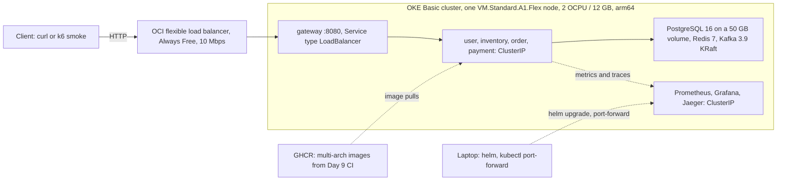

# ShopSage Micro Platform: Plan

English | [简体中文](plan.zh-CN.md)

**Last updated:** 2026-10-23 · **Companion file:** [memory.md](memory.md) (what exists, decisions, how to resume)

This plan answers three questions: what is done, what is not done, and how the rest gets built, including the
optional cloud deployment. It draws on the original project brief and 11-day plan (the author's private master plan of
2026-10-17), the author's private cloud hosting plan (`cloud_hosting_plan_2026-10-17.md`) and this repository. Neither
private file is in this repo, so everything this plan takes from them is restated here.

## 1. Status at a glance

| Area | Status | Evidence |
|---|---|---|
| Day 1: scaffolding | **Done** (2026-10-18) | commit `84aa6d5`; clean-clone `./mvnw verify` green with 27 unit and 15 integration tests, none skipped |
| Days 2-11: features, load and chaos tests, dashboards, CI, Helm, write-up | Not started | no business endpoints, migrations, gateway, CI workflow or Helm chart exist yet |
| Headline numbers (5,000 req/s, p99 ≤ 180 ms, ≥ 99.5 % rollback) | Not measured | the README "Measured" column stays empty until Day 7 |
| Cloud deployment on Oracle Cloud (optional) | Not started | needs the Day 9 images, the Day 10 chart and, for OKE, most likely a Pay As You Go upgrade or the trial (5.3); the Oracle sign-up timing depends on the path (section 7) |
| GitHub | Not pushed | no remote is configured; the author pushes to `createrW/shopsage-micro-platform` |

## 2. Goal and success criteria

A 4-service e-commerce backend (user, inventory, order, payment) behind Spring Cloud Gateway, with Saga choreography
over Kafka, a transactional outbox, Toxiproxy chaos tests and Prometheus/Grafana/Jaeger observability.

| Target | Value | Where it is measured | Status |
|---|---|---|---|
| Throughput through the gateway | ≥ 1,000 req/s with one instance per service; 5,000 req/s headline with services scaled out | local Docker Compose + k6 (Day 7) | not measured |
| Latency p99 at that throughput | ≤ 180 ms on a single machine (the laptop) | same run, spike hold window only | not measured |
| Saga rollback success with 15 % injected failures | ≥ 99.5 % | chaos run: failure knobs + Toxiproxy (Day 7) | not measured |
| CI duration | full pipeline ≤ 5 min | GitHub Actions (Day 9), logged in `docs/experiment_log.md` | not built |

Rules for every number:

- A number counts only after it is logged with its commit and environment in `docs/experiment_log.md`. The README links
  to that row.
- Benchmarks run locally, as the hosting plan says (k6 data does not need a cloud). If 5,000 req/s is out of reach on
  the 16 GB laptop, the README reports the measured number and the bottleneck instead of tuning for the headline
  (`docs/design.md` §16).

## 3. Fixed constraints

- **Stack (do not substitute):** Java 17, Spring Boot 3.2 (pinned 3.2.12), Spring Cloud 2023.0.6 (Gateway), Spring Data
  JPA, Spring Kafka, PostgreSQL 16, Redis 7, Apache Kafka 3 in KRaft mode (3.9.2), Maven multi-module, JUnit 5 +
  Testcontainers, Docker Compose + Helm, Prometheus + Grafana + OpenTelemetry + Jaeger, k6, Toxiproxy, GitHub Actions.
- **Out of scope:** front-end UI, real payments (mock only), multi-region or multi-cluster, gRPC, service mesh.
- **Style:** controller → service → repository, MapStruct, Flyway, minimal Lombok, `/actuator/health`,
  `/actuator/metrics`, `/actuator/info` and `/actuator/prometheus` on every service, all configuration in
  `application.yml` and overridable by environment variables, `traceId`/`spanId` in every log line.
- **Process:** one day of scope per session, and the author names the day. The author pushes to GitHub; development
  sessions never push.
- **Known deviation:** the brief asks for Jaeger traces for every request. Development, tests and chaos verification
  keep sampling at 1.0; only load runs use a lower sampling preset, recorded per run, to protect Jaeger's in-memory
  store. Actuator requests are never traced.

## 4. Roadmap

| Day | Scope (from the brief) | Status |
|---|---|---|
| 1 | Monorepo scaffolding, Docker Compose (Postgres, Redis, Kafka, Prometheus, Grafana, Jaeger), README skeleton, `scripts/dev-up.sh` | **Done** 2026-10-18 |
| 2 | user-service with JWT auth | Not started |
| 3 | inventory-service with Redis cache | Not started |
| 4 | order-service with Kafka publisher + outbox | Not started |
| 5 | payment-service with Kafka consumer + Saga compensation | Not started |
| 6 | Gateway + rate limiting + auth filter | Not started |
| 7 | k6 load tests + Toxiproxy chaos | Not started |
| 8 | Prometheus + Grafana + Jaeger: dashboards and tuning | Not started |
| 9 | GitHub Actions CI: tests, Trivy, multi-arch image push | Not started |
| 10 | Helm chart + minikube deploy | Not started |
| 11 | README, architecture diagram, demo recording | Not started |
| C | Optional cloud deployment on Oracle Cloud (section 5) | Not started; C0 can start now for paths A and C (path B: about a week before Day 10, section 7) |

### Day 1: scaffolding (done 2026-10-18)

Delivered:

- Maven monorepo: parent `pom.xml` (Boot 3.2.12, Spring Cloud 2023.0.6 BOM, CVE overrides, enforcer, JaCoCo, Failsafe),
  the `common` library, four service modules, and Maven Wrapper 3.3.4 pinning Maven 3.9.16 (SHA-256 checked).
- `common`: the `DomainEvent` envelope, `Topics` (ten Saga topics plus `.DLT` naming), an RFC 7807 `GlobalExceptionHandler`,
  and an `ObservationPredicate` that keeps `/actuator` traffic out of traces and latency metrics.
- Four services that boot with health, metrics, info and Prometheus endpoints, an env-overridable `application.yml`,
  an empty Flyway folder and one Testcontainers smoke test each.
- `docker-compose.yml`: Postgres 16 with four databases and roles, Redis 7, Kafka 3.9.2 in KRaft mode plus a one-shot
  `kafka-init` that creates 20 topics, Prometheus, Grafana with provisioned datasources, and Jaeger 2.20.0. Profile
  `tools` adds kafka-ui; profile `app` runs the four services.
- One multi-arch-ready `Dockerfile` (non-root uid 1001) and `scripts/dev-up.sh`, `dev-down.sh`, `dev-env.sh`.
- Docs: README with Mermaid architecture and Saga diagrams, `docs/design.md`, `docs/api_spec.md`,
  `docs/experiment_log.md`, ADR-0001 to ADR-0005, MIT license.

Verified on 2026-10-18 from a clean clone: `./mvnw verify` passed 27 unit and 15 integration tests with none skipped;
`dev-up.sh` brought all six infrastructure containers to healthy with 20 topics and four databases;
`dev-up.sh --with-apps --build` ran all four images healthy, with traces visible in Jaeger.
Re-checked on 2026-10-23 without Docker: `./mvnw -o -DskipITs verify` built every module and passed the 27 unit tests.

### Day 2: user-service with JWT auth

- Flyway `V1` schema for users (unique email, BCrypt hash, roles).
- `POST /api/v1/auth/register` (201), `POST /api/v1/auth/login` (200, returns a JWT), `GET /api/v1/users/me` (USER).
- RS256 tokens with `sub` = userId and a `roles` claim. The public key is served at a JWKS endpoint.
- Key handling: the private key comes from configuration, never from the repo. With no key configured, user-service
  generates an ephemeral RSA key at startup (development and tests only, logged as a warning), and tests create keys in
  code. `.pem` and `.key` files are gitignored, so a committed key fixture would be silently missing from clean clones
  and CI. An ephemeral key only works with one user-service replica, so the scaled runs on Day 7 set a fixed key.
  Decide the key's encoding: base64 on one line fits environment variables and env files, which a multi-line PEM does
  not. Name the variables (for example `JWT_PRIVATE_KEY`, `JWT_JWKS_URI`) in `docs/design.md` §11 and `.env.example`;
  the JWKS URI is `localhost:8081` on the host and `user-service:8081` inside compose.
- Admin bootstrap: user-service creates or promotes one ADMIN account from two variables (for example `ADMIN_EMAIL`,
  `ADMIN_PASSWORD`) when both are set. There is no default value. Map both in the compose user-service `environment:`
  block (empty unless set), list them in `.env.example` and `docs/design.md` §11, and export them in the shell for host
  runs; the real values live only in the gitignored `.env`. Tests mint ADMIN tokens directly.
- A servlet security auto-configuration in `common`: maps `roles` to `ROLE_*` authorities; permits the whole health
  endpoint, including `/actuator/health/readiness` and `/actuator/health/liveness` (for example
  `EndpointRequest.to("health", "info", "prometheus")`), plus info, Prometheus and the anonymous routes; answers
  401/403 as ProblemDetail.
- Every service becomes an OAuth2 resource server that validates tokens against the JWKS key (`docs/design.md` §9).
- Update the Day 1 smoke tests in all four services: anonymous calls to `/actuator/metrics` and to an unknown route
  start getting 401. Decide whether `/actuator/metrics` needs a token or an explicit permit; an anonymous unknown route
  then expects a 401 ProblemDetail and an authenticated one still a 404. Readiness, info and Prometheus stay anonymous
  in the tests, because compose healthchecks, Prometheus and Kubernetes probes call them without a token. Change
  expectations, never delete tests.
- Fill the Day 2 TODOs in `docs/api_spec.md`: request and response bodies, password policy, token lifetime.

**Done when:** integration tests cover register, duplicate email (409), login, wrong password (401), and `/users/me`
with valid, expired and tampered tokens; all 15 Day 1 smoke tests still pass with their updated expectations;
`dev-up.sh --with-apps` still reports every service healthy; `./mvnw verify` is green; the README roadmap box is
ticked.

### Day 3: inventory-service with Redis cache

- Flyway schema for products (SKU, name, price in minor units, currency), stock and reservations.
- `GET /api/v1/products` (paged), `GET /api/v1/products/{sku}` (cached), `POST /api/v1/products` and
  `PUT /api/v1/products/{sku}/stock` (ADMIN), `GET /api/v1/inventory/reservations/{orderId}`.
- Redis write-through cache `inventory:stock:<sku>` with a TTL. Postgres stays the source of truth: a reservation is a
  conditional update (`available >= quantity`), and the cache is refreshed after commit, so even a stale cache can
  never oversell.
- A seed catalog CSV in `data/samples/`.
- Fill the Day 3 TODOs in `docs/api_spec.md`: product and reservation schemas, `PUT .../stock` semantics (absolute
  value or delta) and its concurrency control.
- **Decide:** one currency (USD) or a currency per product; the cache TTL.

**Done when:** against a Redis container, the cached `inventory:stock:<sku>` equals the database value after a stock
update or a reservation commits (write-through); a miss loads from Postgres; an entry expires after the configured TTL;
and a concurrent-reservation test shows no oversell.

### Day 4: order-service with Kafka publisher + outbox

- order-service: the orders table and `POST /api/v1/orders` (202 + `Location`, `Idempotency-Key` required). It writes
  the order and its `order.created` event to the `outbox` table in one transaction. This is the outbox's first
  producer; the API spec and design §3 were updated on 2026-10-23 to land this endpoint on Day 4.
- Outbox relay: one active relay per service (Postgres advisory lock), rows published in order per order id with the
  idempotent producer (`acks=all`); the trace context is rebuilt from the stored `traceparent` (`docs/design.md` §7).
- Shared consumer plumbing: the `processed_events` dedupe table, retries, and dead-letter publishing to `<topic>.DLT`.
- The two tests planned in `docs/design.md` §12: a relayed record carries exactly one `traceparent`, with the
  request's trace id; every `@KafkaListener` id is unique and starts with the service name.
- **Decide:** outbox retention (delete after N days, or a partitioned table); the `type` URN for the 422.

**Done when:** one POST yields exactly one `order.created`; replaying the same key returns the original order, and the
same key with a different body returns 422; events written while Kafka is down are published once it is back.

### Day 5: payment-service with Kafka consumer + Saga compensation

- inventory-service consumes `order.created` and emits `inventory.reserved` (with authoritative prices) or
  `inventory.rejected`.
- payment-service (mock provider) consumes `inventory.reserved` and emits `payment.captured` or `payment.failed`. It
  always answers `order.cancelled` with `payment.refunded`, idempotently per order: outcome `REFUNDED`, or `VOIDED`
  when nothing was captured, in which case it records the void so a late `inventory.reserved` is never captured. It
  also refunds on `shipping.failed`.
- inventory-service compensates: it releases the reservation on `payment.failed`, `shipping.failed` and
  `order.cancelled` and always answers with `inventory.released` (empty lines when nothing was held). It records
  cancellations so a late `order.created` is not reserved, lets reservations expire on their own after
  `SAGA_TIMEOUT_SECONDS + 15` s with an `inventory.released`, and turns a reservation into a committed deduction on
  `shipping.dispatched` (`docs/design.md` §4.3-4.4).
- order-service state machine `PENDING → RESERVED → PAID → COMPLETED`. Failures go to `COMPENSATING`, then to
  `CANCELLED(reason)` only after the compensation acks arrive. A 30 s timeout sweeper and simulated shipping
  (`shipping.dispatched`, `shipping.failed`) complete the flow. A `payment.captured` that arrives in `COMPENSATING` or
  `CANCELLED` re-emits `order.cancelled` so payment refunds (`docs/design.md` §4.4).
- The read endpoints: `GET /api/v1/orders/{id}`, `GET /api/v1/orders` and `GET /api/v1/orders/{id}/payment`, which
  payment-service answers. Optionally `GET /api/v1/admin/orders` (ADMIN), which would also need a gateway route on Day 6.
- Failure knobs `PAYMENT_FAILURE_RATE`, `SHIPPING_FAILURE_RATE` and `INVENTORY_FAILURE_RATE`, default 0.
- Fill the Day 5 TODOs: order and payment response schemas in `docs/api_spec.md`, shipping payload fields in
  `docs/design.md` §5.3.

**Done when:** integration tests pass for the happy path, every compensation path with its required acks, duplicate
delivery, timeouts and out-of-order events: `payment.captured` before `inventory.reserved`, and an `order.cancelled`
that reaches payment before `inventory.reserved`, which must end `VOIDED` with no later capture. One Saga appears as
one trace in Jaeger.

### Day 6: gateway + rate limiting + auth filter

- New module `services/gateway` (port 8080, Spring Cloud Gateway on WebFlux) with the routes in `docs/design.md` §9.
- JWT validation through the JWKS key. The gateway strips any client-sent `X-User-Id` and sets it from the token
  subject.
- Redis token-bucket `RequestRateLimiter`, keyed by user id (client IP on anonymous routes); rejections return 429
  with `Retry-After`; errors are ProblemDetail.
- Nothing under `/actuator/**` is reachable through `:8080` (the Day 6 TODO in `docs/api_spec.md`): there is no route
  for it, and the gateway's own actuator listens on a separate management port that no public Service exposes.
- Add the gateway to the compose `app` profile, the Dockerfile dependency-cache list and the Prometheus targets.
- **Decide:** one Redis instance with separate logical databases, or two instances; how the gateway spreads requests
  across service replicas in the Day 7 scaled runs (Docker DNS round-robin or Spring Cloud LoadBalancer).

**Done when:** every API call works through `:8080`, a bad token gets 401 at the gateway, a burst gets 429,
`GET :8080/actuator/prometheus` never returns metrics (401 without a token, 404 with a valid one), and the gateway
tests are green.

### Day 7: k6 load tests + Toxiproxy chaos

- `tests/load/`: baseline (constant 1,000 req/s), spike (ramp to 5,000 req/s, then hold N minutes; QPS and p99 come from
  the hold window), and chaos (steady load while failures are injected).
- Scaled runs: a compose override that drops the fixed host ports of the app services (a plain list merges with the
  base file, so use `ports: !reset []`), so `docker compose --profile app up --scale order-service=N` (and likewise for
  the others) runs replicas behind the gateway. Three things go with it:
  - Prometheus scrapes every replica through a `dns_sd_configs` job that replaces the file-based docker targets
    during scaled runs: the docker file lists one address per service and would sample a single replica, and running
    both jobs would double count (design §10). `dev-up.sh` accepts only `host` or `docker` today, so it gains a mode
    for this.
  - Replicas × `DB_POOL_SIZE` stays below Postgres `max_connections` (200, of which 3 are reserved for superusers):
    lower the pool size for scaled runs, or raise the limit.
  - Every run records the replica count and pool size per service. One active outbox relay per service (ADR-0003)
    caps publish throughput whatever the replica count.
- Toxiproxy in compose (profile `chaos`, API 8474) proxying 15432 to Postgres, 16379 to Redis and 39092 to a Kafka
  `CHAOS` listener.
- `tests/chaos/`: set the knobs to 0.15, add Toxiproxy toxics, drive load, then compute rollback success: the share of
  failed or timed-out orders that reach `CANCELLED` with all required compensation acks within 60 s (target ≥ 99.5 %),
  overall and over compensation-required Sagas only, plus failed Sagas by reason, as defined in
  `docs/experiment_log.md`.
- First rows in `docs/experiment_log.md` and the README headline table, including a single-instance throughput row from
  the baseline run (≥ 1,000 req/s); first versions of the README "Benchmarks" and "Chaos test results" sections.
- **Decide:** the k6 scenario mix, warm-up and steady-state durations, the spike's ramp length and hold time N, and the
  chaos load rate (the Day 7 TODO in `docs/experiment_log.md`); the rate-limiter settings for load runs, because k6
  runs from one machine and the Day 6 limiter would otherwise cap the measured rate (buckets sized for the test, or the
  limiter off for benchmark runs, recorded on a new "Rate limits" line of the environment template); partitions per
  topic; whether 5,000 req/s is reachable on the laptop.

**Done when:** all three scenarios have logged runs with commit, environment, replica counts and rate-limit settings,
and each chaos row has both rollback percentages and the by-reason counts.

### Day 8: Prometheus + Grafana + Jaeger

- Dashboards in `configs/grafana/dashboards/shopsage/`: `services.json` (RED metrics, JVM, Hikari), `saga.json`
  (throughput, compensations, rollback %, outcomes by reason, outbox backlog, consumer lag, DLT counts) and
  `infra.json`.
- `infra.json` needs a choice, since nothing exports Postgres, Redis or Kafka broker metrics yet: add exporters to
  compose, Prometheus and the Day 10 chart (multi-arch, non-Bitnami images, memory counted in the budgets), or build the
  dashboard from client-side metrics only (Hikari, Lettuce, Kafka client metrics, Jaeger's own metrics) and update
  `configs/grafana/dashboards/README.md`.
- Alert rules in `configs/grafana/provisioning/alerting/`: rollback success below 99.5 %, DLT growth, consumer lag,
  p99 above 180 ms.
- SLOs (p99 latency, error rate, rollback success) with their PromQL, written into `docs/design.md` §10.
- A trace-sampling preset for load runs (section 3), Jaeger `max_traces` tuning, and an `X-Trace-Id` response header
  from `common`.

**Done when:** Grafana lists the three dashboards from provisioning; during a logged chaos run every panel returns
data; the SLOs and their PromQL are in `docs/design.md` §10; the screenshots are committed.

### Day 9: GitHub Actions CI

- `.github/workflows/ci.yml`: build, unit tests, Testcontainers integration tests, a Trivy scan (accepted findings in
  `.trivyignore.yaml`), and multi-arch (`linux/amd64` + `linux/arm64`) images pushed to GHCR from `main`. The arm64
  image can be built natively on GitHub's `ubuntu-24.04-arm` runners, which are free for public repositories, or
  cross-built with buildx.
- Dependabot configuration; the real CI badge replaces the README placeholder.
- The duration of the first green pipeline (run URL and commit) logged in `docs/experiment_log.md`, plus a CI row in
  the README headline table.
- **Prerequisite:** the author has pushed the repository to GitHub.

**Done when:** a push to `main` runs the whole pipeline in ≤ 5 min and publishes images whose manifests list both
architectures.

### Day 10: Helm chart + minikube

- Chart in `deploy/helm/shopsage/`: Deployments for the gateway and the four services with actuator liveness and
  readiness probes, ClusterIP Services, NetworkPolicies, ConfigMaps and Secrets, and in-cluster Postgres, Redis, Kafka
  (KRaft), Prometheus, Grafana and Jaeger using the same images as compose. No Bitnami charts: their catalog moved
  behind a paywall in 2025.
- Fully qualified image names (for example `docker.io/library/postgres:16.15-alpine`): OKE's container runtime rejects
  short names from Kubernetes 1.34.1, and the full names work on minikube too.
- Topics are created on every Kafka start, not only by a Helm hook, which runs only on install and upgrade: a sidecar
  in the Kafka pod retries the idempotent `configs/kafka/create-topics.sh` until it succeeds and then stays alive (for
  example `until create-topics.sh; do sleep 5; done; while true; do sleep 3600; done`). It must not exit, because a
  Deployment or StatefulSet restarts an exited container and the pod is not Ready meanwhile. A rescheduled broker so
  gets its 20 topics back.
- The gateway Service is the only entry point; no ingress controller (the community ingress-nginx controller was
  retired in March 2026).
- `configs/deploy/values-minikube.yaml`, plus a first draft of `configs/deploy/values-oke.yaml` that step C2 finishes.
- Run the chart on minikube once with the default-node limits from 5.5 and record each pod's peak memory, so step C2
  starts from measured limits.
- Hardened posture: no default credentials, Grafana anonymous access off, Prometheus lifecycle API off, `runAsNonRoot`.
- The README "Kubernetes" entry, still a TODO, replaced with `helm install` steps for minikube.

**Done when:** `helm install` on minikube brings every pod to Ready and an order completes end to end through the
gateway.

### Day 11: README, diagram, demo

- Final benchmark and chaos runs; the README headline table, "Benchmarks" and "Chaos test results" sections filled
  from `docs/experiment_log.md`, with the k6 tables and Grafana screenshots.
- First screen: the one-liner with the measured numbers, the CI badge and the architecture diagram. The brief's draft
  one-liner says "on Kubernetes", while the numbers come from Docker Compose; the wording must say where they were
  measured.
- A "Trade-offs and limitations" section, with the trade-offs backed by measurements (partitions vs consumer
  parallelism, relay latency, cache hit ratio vs staleness).
- A demo GIF and a demo video (2 minutes per the master plan; see section 8).
- The final one-line project summary; if section 5 is done, the one-line deployment summary and its evidence.

**Done when:** no TODO markers remain in `README.md`; each headline row links to a dated row in
`docs/experiment_log.md`; the first screen shows the one-liner with numbers, the CI badge and the diagram; the GIF is
embedded and the video linked; the Kubernetes section has the `helm install` steps.

## 5. Cloud deployment plan (optional, follows the hosting plan)

### 5.1 What the hosting plan decides

The hosting plan covers all of the author's portfolio projects. For this one it says:

| Topic | Decision in the hosting plan |
|---|---|
| Need | Optional. Local Docker Compose is enough to show every benchmark (k6 data needs no cloud), and the README on its own (Mermaid diagram, local benchmark screenshots, a demo video) is rated as enough. |
| Provider | Oracle Cloud Always Free, permanently $0: Ampere A1 ARM capacity of 4 OCPU and 24 GB RAM in total, 200 GB block storage, one load balancer (10 Mbps), 10 TB/month outbound traffic. |
| Platform | OKE (Oracle Kubernetes Engine): free control plane, worker nodes from the A1 quota. |
| Shape | Not consistent within the hosting plan. Its section on this project (§2.2) proposes a slimmed version, 2-3 services and Postgres, on a free ARM instance under OKE. Its capacity table (§3.1), its budget tiers (Part 4) and its one-line deployment summary (Part 7) assume the full stack: four services plus Prometheus/Grafana. This plan deploys the full stack and keeps the slimmed version as the fallback (section 8). |
| Alternative | AWS Free Tier with ECS Fargate. The hosting plan signs up for AWS mainly for another project (Observatory), paid from GitHub Student Pack credit. Its price table puts Fargate at about $2 a week, the price of one minimum-size task. |
| Constraints | ARM, so images need arm64 builds (the hosting plan says only some images need multi-arch; this repo requires it for every image, ADR-0004). Sign-up needs a credit card ($1 verification charge); Visa or Mastercard is recommended because UnionPay cards are sometimes rejected. Activation can take 1-3 days, and the console takes 2-3 days to learn. |
| Cost rules | A $5 billing alert. Tear resources down as soon as the project is done instead of leaving them running, and bring them back briefly for a live demo (stated for the hosting plan's Terraform project). |
| Footprint | About 10 GB of data; $0 a month for this project. |
| One-line deployment summary | "Deployed to Oracle Cloud OKE (Kubernetes) on free-tier 24 GB ARM instance; Helm chart for 4 services + Prometheus/Grafana monitoring stack." |

Already in place for it: every third-party image pin is published for `linux/amd64` and `linux/arm64`, and the root
Dockerfile cross-builds (`FROM --platform=$BUILDPLATFORM`, ADR-0004). The service images become multi-arch with the
Day 9 CI (step C1), and `configs/deploy/README.md` reserves `values-oke.yaml`.

### 5.2 What Oracle's documentation says now (checked 2026-10-23)

Oracle cut its free tier on 2026-06-15. One of the hosting plan's assumptions (the A1 allowance) no longer holds, and
a second (OKE on a free account) most likely does not. Where the two differ, this plan follows Oracle's current
documentation. Sources are in 5.10; re-check them at C0.

| Topic | Hosting plan | Oracle, October 2026 | Effect on this plan |
|---|---|---|---|
| Free Ampere A1 capacity | 4 OCPU + 24 GB | "All tenancies get the first 1,500 OCPU hours and 9,000 GB hours per month for free", which is 2 OCPU and 12 GB. Oracle's price list still offers paid tenancies 3,000 OCPU-hours and 18,000 GB-hours; Oracle has not reconciled the two. | Keep the A1 total at 2 OCPU / 12 GB at all times; a 31-day month at that size uses 1,488 of the 1,500 free OCPU-hours, so a second A1 instance would be billed. Cost Analysis cannot confirm a larger size in advance: the allowance counts hours per month, so a 4 OCPU / 24 GB node shows $0 until about day 16 whichever figure is right. If 1,500/9,000 applies, every later hour costs about $0.076, roughly $26-28 a month at A1 list prices. Move to 4 OCPU / 24 GB only if Oracle's documentation states that allowance for the account type. Write the one-line deployment summary with the node size actually used. |
| OKE on a free account | free control plane, workers from the A1 quota | Basic clusters are free; Enhanced clusters cost $0.10 per cluster-hour. The OKE service limits give values only for "Universal Credits" and "Pay As You Go or Trial" tenancies, and users report a cluster limit of 0 on Always-Free-only accounts. | OKE most likely needs a Pay As You Go upgrade or the 30-day trial (5.3). |
| Load balancer | one, 10 Mbps | Confirmed: one Always Free flexible load balancer at 10 Mbps. Without shape annotations OKE creates a 100 Mbps load balancer, which is not free. | The three annotations in 5.6 are mandatory on paths A and B. |
| Block storage | 200 GB | Confirmed: 200 GB of boot and block volumes combined. Every volume, and every persistent volume claim, is at least 50 GB. | The hosting plan's 10 GB is the data size; the allocation is about 100 GB (5.4). |
| Billing alert | $5 alert | Budgets accept amounts from $1, but Oracle evaluates budget alerts once every 24 hours. | An alert reports a mistake up to a day late, so the preventive guardrails in 5.7 matter more. |

### 5.3 Three ways to run it (the author decides at C0)

| Path | What | Cost | Result |
|---|---|---|---|
| **A. Pay As You Go + OKE (recommended)** | Upgrade the account to Pay As You Go, then create an OKE Basic cluster with one A1 node. | $0 while usage stays inside the Always Free allowances; anything beyond is billed to the card. | OKE. Under the hosting plan's rule it is torn down after C5 and redeployed for live demos; keeping it running while the bill is $0 departs from that rule and is the author's call. |
| B. OKE during the 30-day trial | Sign up about a week before Day 10, deploy while the $300 trial credit lasts, capture the evidence (C5), tear down before the trial ends. | $0 cash. | OKE for the evidence window only. |
| C. No upgrade | One Always Free A1 VM (2 OCPU / 12 GB) in a public subnet running k3s and the same Helm chart. | $0. | Kubernetes on Oracle Cloud, but not OKE; the deployment summary says k3s. |

Path A follows the hosting plan most closely. Its price is exposure: a mistake can bill the card, which is what the
guardrails in 5.7 are for. Path B avoids that exposure but needs the sign-up timed so the trial covers Day 10 to C5;
signing up earlier rules it out unless Day 10 to C5 fall inside the 30 days. Path C suits an author who wants no
billable account at all. It departs from the hosting plan, which names OKE wherever it names a platform (§2.2, §3.1,
Part 7).

### 5.4 Target topology (path A)



- **Cluster:** an OKE Basic cluster, chosen explicitly: the console proposes Enhanced, and the CLI and API default
  switches to Enhanced on 2027-06-15. It sits in the tenancy's home region, where Always Free resources live, on the
  current production Kubernetes line (1.36.x in October 2026; 1.37 is a preview) with an Oracle Linux 8 aarch64 node
  image.
- **Node:** one `VM.Standard.A1.Flex` node with 2 OCPU and 12 GB, the size Oracle documents as free. It uses the whole
  free A1 allowance. If ChatterHub's backend also moves to Oracle, as the hosting plan suggests, run it in the same
  cluster in its own namespace; a second A1 instance would be billed. This stack needs about half the node.
- **Exposure:** only the gateway is public, through the free flexible load balancer with the annotations in 5.6.
  Grafana, Jaeger and Prometheus stay private and are reached with `kubectl port-forward`.
- **Storage:** Postgres on one 50 GB claim of the default `oci-bv` storage class. Kafka, Prometheus and Jaeger use
  ephemeral storage, since the demo data is disposable; the Kafka topic sidecar from Day 10 recreates the topics after
  any restart. With a 50 GB boot volume this allocates about 100 GB of the 200 GB allowance.
- **Images:** `ghcr.io/createrw/shopsage-<service>:<git-sha>` (GHCR image names are lowercase) and fully qualified
  third-party names (Day 10). Make the GHCR packages public, or add an image pull secret.
- **Secrets:** database passwords, the JWT signing key, the bootstrap ADMIN credentials and the Grafana admin password
  live in `secrets/oke.env`, which `**/secrets/` in `.gitignore` keeps out of git. They become a Kubernetes Secret and
  are never committed.
- **TLS:** optional. With a domain, use cert-manager and Let's Encrypt. Without one, serve HTTP on the load balancer IP
  for a short demo window, with throwaway accounts only.

### 5.5 Memory budget

These are estimates; Day 10 measures the default-node column on minikube.

| Component | Default node (2 OCPU / 12 GB) | Larger node (4 OCPU / 24 GB), only if Oracle documents it as free |
|---|---|---|
| gateway + 4 services, one replica each | 5 × 512 MiB | 5 × 1 GiB |
| PostgreSQL | 512 MiB | 1 GiB |
| Redis | 128 MiB | 384 MiB |
| Kafka (single KRaft node) | 768 MiB | 1.5 GiB |
| Prometheus / Grafana / Jaeger | 512 MiB / 256 MiB / 384 MiB | 1 GiB / 512 MiB / 1 GiB |
| Kubernetes system pods, reserve | about 1 GiB | about 1 GiB |
| **Total** | **about 6 GiB** | **about 11.4 GiB** |

The default node has memory to spare. CPU is the tighter limit: five JVMs starting at once on 2 OCPU need startup
probes with generous timeouts. If the full stack does not run well on the node obtained, fall back to the hosting
plan's slimmed version (2-3 services and Postgres); it still needs an A1 instance.

### 5.6 Steps

| Step | When | What | Done when | Who |
|---|---|---|---|---|
| C0 | now for paths A and C; about a week before Day 10 for path B | Sign up for Oracle Cloud and enable MFA (the hosting plan's anti-abuse rule, applied to Oracle). Choose the home region, which cannot be changed later (free A1 is not offered in South Korea North). Re-check Oracle's terms: Always Free limits, OKE Basic and Enhanced pricing, the block volume minimum, the idle rules. Pick path A, B or C, and for A upgrade to Pay As You Go. Create budget alerts at $5 (hosting plan rule) and $1. Install the OCI CLI, `kubectl` and `helm`. | account active with MFA, path chosen, alerts set | author |
| C1 | after Day 9 | CI publishes `linux/amd64` + `linux/arm64` images to GHCR | `docker buildx imagetools inspect` lists `linux/arm64` | dev session |
| C2 | after Day 10 | Finish `configs/deploy/values-oke.yaml` (drafted on Day 10) for the chosen path. Paths A and B: resource limits for the node from the Day 10 measurements, the gateway Service annotations below, the `oci-bv` storage class, image tags, hardened posture. Path C: the same limits and posture, the `local-path` storage class (Postgres then lives on the VM's boot volume, with no 50 GB claim), and no OCI annotations, because k3s's built-in service load balancer publishes the gateway port on the VM's own IP. | `helm lint` and `helm template` pass | dev session |
| C3 | after C0 and C2 | Paths A and B: create the Basic cluster and a node pool with one A1 node, then fetch the kubeconfig. Path C: create the A1 VM in a public subnet and install k3s; open only the gateway port in the VCN security list and the VM's firewall, and reach the Kubernetes API through an SSH tunnel (`ssh -L 6443:127.0.0.1:6443 <vm>`) instead of opening port 6443. | `kubectl get nodes` shows an arm64 node Ready | author, with session help |
| C4 | after C3 | Write `secrets/oke.env` and confirm `git check-ignore secrets/oke.env` prints it; create the Secret; `helm upgrade --install`; run the smoke flow: register a user, log in as the bootstrap ADMIN and create a product, place an order as the user, poll until `COMPLETED` | all pods Ready; an order completes through the public endpoint | dev session |
| C5 | after C4 | Evidence: node and pod listings, Grafana and Jaeger screenshots; ADR-0006 for the cloud topology; README deployment section; an `experiment_log.md` row marked "cloud smoke test, not a benchmark" | the README deployment section names the cluster type and node size and links the listings and the smoke-test row | dev session |
| C6 | ongoing | Check Cost Analysis 24 h after the first deploy, then weekly. Sign in at least monthly, because Oracle may suspend accounts left idle for 30 days. Tear down when the demo window ends, as the hosting plan's rule says, and redeploy from these steps when a live demo is needed (A1 capacity is needed again then); for path B, tear down before the trial ends. | bill stays at $0 | author |

Annotations on the gateway Service (paths A and B). The bandwidth values take no unit.

```yaml
service.beta.kubernetes.io/oci-load-balancer-shape: "flexible"
service.beta.kubernetes.io/oci-load-balancer-shape-flex-min: "10"
service.beta.kubernetes.io/oci-load-balancer-shape-flex-max: "10"
```

Command sketch for C3-C6 on path A. Release, secret and value names are illustrative until the Day 10 chart fixes
them. An env file takes one `KEY=VALUE` per line, so the JWT private key goes in base64 on one line (Day 2 decides the
encoding), or into a separate Secret created with `--from-file` from a `.pem` under `secrets/`.

```bash
# C3: kubeconfig for the new cluster (after `oci setup config`)
oci ce cluster create-kubeconfig --cluster-id <cluster-ocid> --file ~/.kube/config \
  --region <home-region> --token-version 2.0.0 --kube-endpoint PUBLIC_ENDPOINT
kubectl get nodes -L kubernetes.io/arch                  # expect arm64

# C4: secrets first (secrets/ is gitignored; never commit them), then the chart
git check-ignore secrets/oke.env                         # must print the path
kubectl create namespace shopsage
kubectl -n shopsage create secret generic shopsage-secrets --from-env-file=secrets/oke.env
helm upgrade --install shopsage deploy/helm/shopsage -n shopsage \
  -f configs/deploy/values-oke.yaml --set image.tag=<git-sha>
kubectl -n shopsage get pods -o wide
kubectl -n shopsage port-forward svc/grafana 3000:3000   # dashboards stay private

# C6: teardown in this order; deleting the cluster alone leaves the load balancer, volumes and VCN behind
helm uninstall shopsage -n shopsage
kubectl -n shopsage delete pvc --all
# then confirm in the console that no load balancer or block volume is left,
# and delete the node pool, the cluster and the VCN
```

### 5.7 Guardrails that keep it at $0

- Create only Always Free resources, in the home region: A1 capacity within 2 OCPU and 12 GB in total at all times,
  a Basic cluster chosen explicitly, and a single LoadBalancer Service, the gateway's, carrying the three annotations
  above.
- Keep block storage at or under 200 GB in total, boot volumes included. Each volume and each persistent volume claim
  takes at least 50 GB, whatever it requests.
- Keep the $5 budget alert from the hosting plan, plus a $1 alert. Both can fire up to 24 hours after the spend, so
  check Cost Analysis yourself the day after any change.
- Before deleting the cluster, delete the LoadBalancer Service and the persistent volume claims, and wait until the
  load balancer and the volumes are gone. Deleting a cluster removes neither them nor the VCN.
- No paid upgrades: no Enhanced cluster, no larger load balancer shape, no extra volumes, no second LoadBalancer
  Service.

### 5.8 Risks

| Risk | Effect | Mitigation |
|---|---|---|
| The free A1 allowance is half what the hosting plan assumed | the full-size limits do not fit, and "24 GB" in the deployment summary would be wrong | plan for 2 OCPU / 12 GB (about 6 GiB needed); write the summary from the node actually used |
| OKE is unavailable on an Always-Free-only account | C3 fails with a cluster limit of 0 | path A (upgrade), path B (trial) or path C (k3s on a VM) |
| No A1 capacity in the home region | node creation fails with "Out of host capacity" | retry later or in another availability domain (Oracle says it can take several days); Oracle also suggests upgrading to Pay As You Go |
| Oracle sign-up is rejected, or A1 stays unavailable for weeks | no cloud phase on Oracle | the hosting plan's alternative is AWS ECS Fargate on Student Pack credit. Its "$2 a week" is one minimum-size task; this stack runs about 11 containers needing about 6 GiB, so it would cost many times that, and the credit would last weeks rather than months. Follow the hosting plan's AWS rules (a $5 billing alarm, no NAT Gateway); the author decides. |
| Pay As You Go exposes the card | a mistake bills real money | the guardrails in 5.7, the two alerts, and a Cost Analysis check after every change |
| Oracle reclaims idle Always Free instances | the node can be stopped after an idle week | the rule needs CPU, network and memory all under 20 % (95th percentile) for 7 days; a node running this stack normally uses more memory than that |
| The Kafka pod is rescheduled | its ephemeral storage and the topics go with it, and orders stall | the topic sidecar from Day 10 recreates the topics on every broker start |
| The account sits unused for 30 days | suspension or termination; Always-Free-only accounts get no Oracle Support | sign in at least monthly (C6) |
| Account activation takes 1-3 days | blocks C3 | do C0 early |
| The free load balancer is capped at 10 Mbps | the cloud cannot show the throughput numbers | benchmarks stay local, as the hosting plan says; cloud runs are smoke tests only |
| A public endpoint attracts abuse | cost or security exposure | only the gateway is public, behind JWT and rate limiting; no real credentials; tear down after the demo window |
| Bitnami images and charts are paywalled | community charts break | the chart uses official images (ADR-0004) |

### 5.9 Not in scope for the cloud phase

Terraform for this project (the hosting plan uses Terraform for Observatory), AWS unless the author switches to the
hosting plan's alternative, multi-region, service mesh, and autoscaling to chase benchmark numbers in the cloud.

### 5.10 Sources (checked 2026-10-23)

- Oracle, Always Free resources (A1 allowance, idle reclamation, block storage, load balancer):
  https://docs.oracle.com/en-us/iaas/Content/FreeTier/freetier_topic-Always_Free_Resources.htm
- Oracle, Free Tier overview (trial credit, end of trial): https://docs.oracle.com/en-us/iaas/Content/FreeTier/freetier.htm
- Oracle, price list (paid-tenancy A1 allowance, A1 prices, Basic and Enhanced clusters): https://www.oracle.com/cloud/price-list/
- InfoQ, "Oracle Quietly Halves Free Tier Ampere A1 Compute Limits" (2026-07-03):
  https://www.infoq.com/news/2026/07/oracle-cloud-free-tier-limits/
- Oracle, service limits (Kubernetes Engine): https://docs.oracle.com/en-us/iaas/Content/General/Concepts/servicelimits.htm
- Oracle, Basic and Enhanced clusters:
  https://docs.oracle.com/en-us/iaas/Content/ContEng/Tasks/contengcomparingenhancedwithbasicclusters_topic.htm
- Oracle, load balancers for OKE Services:
  https://docs.oracle.com/en-us/iaas/Content/ContEng/Tasks/contengcreatingloadbalancers-subtopic.htm
- Oracle, persistent volume claims on block volumes:
  https://docs.oracle.com/en-us/iaas/Content/ContEng/Tasks/contengcreatingpersistentvolumeclaim_topic-Provisioning_PVCs_on_BV.htm
- Oracle, deleting a cluster: https://docs.oracle.com/en-us/iaas/Content/ContEng/Tasks/contengdeletingcluster.htm
- Oracle, Kubernetes versions on OKE (image short names):
  https://docs.oracle.com/en-us/iaas/Content/ContEng/Concepts/contengaboutk8sversions.htm
- Oracle, service changes (Oracle Linux 7 Arm images, cluster-type default): https://docs.oracle.com/iaas/Content/servicechanges.htm
- Oracle, budgets: https://docs.oracle.com/en-us/iaas/Content/Billing/Concepts/budgetsoverview.htm
- Oracle, Free Tier FAQ (capacity, idle accounts, support): https://www.oracle.com/cloud/free/faq/
- Kubernetes blog, "Ingress NGINX Retirement: What You Need to Know" (2025-11-11):
  https://kubernetes.io/blog/2025/11/11/ingress-nginx-retirement/
- GitHub changelog, arm64 hosted runners for public repositories GA (2025-08-07):
  https://github.blog/changelog/2025-08-07-arm64-hosted-runners-for-public-repositories-are-now-generally-available/

## 6. What is not done yet

- **Code:** no business endpoints, entities, repositories, mappers or Flyway migrations; no Spring Security or JWT; no
  Redis cache code; no outbox, relay or idempotent consumers; no Saga logic; no `services/gateway` module.
- **Tests:** no k6 scripts, Toxiproxy service or chaos scenarios; no measured numbers.
- **Operations:** no Grafana dashboards or alert rules; no `.github/` workflows, Dependabot or Trivy configuration; no
  published images; no Helm chart or values files.
- **Presentation:** no demo GIF or video; the README headline table and benchmark sections are TODOs.
- **Cloud:** no Oracle Cloud account confirmed and no resources created.
- **Repository:** not pushed to GitHub.

## 7. Next actions

1. **Author:** push the repository, for example with
   `gh repo create createrW/shopsage-micro-platform --public --source=. --push`. Day 9 CI needs the remote. Optional,
   before the first push: the commits carry the author's university email. To publish the GitHub no-reply address
   instead, set it and rewrite the unpushed commits:

   ```bash
   # ID is the number in the no-reply address shown under GitHub Settings → Emails
   git config user.email "ID+createrW@users.noreply.github.com"
   git rebase --root --exec 'git commit --amend --no-edit --author="Yi Zhao <ID+createrW@users.noreply.github.com>"'
   ```

2. **Author:** decide first whether path B (OKE inside the 30-day trial) is wanted, because signing up starts the
   trial clock. If not, sign up for Oracle Cloud now: the hosting plan treats the account as required for the whole
   portfolio, and activation can take 1-3 days; then pick A or C at C0. If path B is wanted, sign up about a week
   before Day 10 instead.
3. **Next development session:** Day 2, user-service with JWT auth.

## 8. Open decisions

| Decision | Options | Decide on |
|---|---|---|
| `/actuator/metrics` after Day 2 | requires a token, or is explicitly permitted | Day 2 |
| JWT private key encoding | base64 on one line in an environment variable, or a PEM file mounted from a Secret | Day 2 |
| Currency | single USD, or a currency per product | Day 3 |
| Outbox retention | delete after N days, or a partitioned table | Day 4 |
| Redis for cache and rate limits | one instance with separate logical databases, or two instances | Day 6 |
| Load spreading in scaled runs | Docker DNS round-robin, or Spring Cloud LoadBalancer | Day 6-7 |
| Rate limits in load runs | buckets sized for the test, or the limiter off for benchmark runs | Day 7 |
| Partitions per topic | 3 caps consumer parallelism at 3 per group | Day 7 |
| 5,000 req/s on the laptop | if out of reach, report the measured number and the bottleneck | Day 7 |
| Infrastructure metrics | Postgres, Redis and Kafka exporters, or client-side metrics only | Day 8 |
| Demo video length | 2 minutes (master plan) or up to 10 minutes (hosting plan) | Day 11 |
| Cloud path | A: Pay As You Go + OKE; B: OKE inside the trial; C: k3s on an Always Free VM | before signing up (path B) or at step C0 |
| Cloud shape | the full stack, or the hosting plan's slimmed version | step C2 |
| Node size | 2 OCPU / 12 GB (free per Oracle's documentation); 4 OCPU / 24 GB only if Oracle's documentation states it is free for the account type, since a Cost Analysis check cannot show it | step C3 |
| Public TLS | domain with cert-manager, or HTTP for a short demo window | step C4 |
