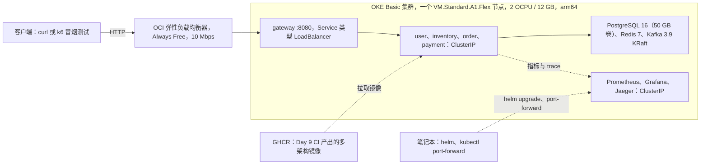

# ShopSage Micro Platform：项目计划

[English](plan.md) | 简体中文

**最后更新：** 2026-10-23 · **配套文件：** [memory.zh-CN.md](memory.zh-CN.md)（现有内容、关键决策、如何接续）

本计划回答三个问题：做完了什么、还没做什么、剩下的怎么做，包括可选的云端部署。依据有三份：原始项目 brief 与 11 天计划（作者 2026-10-17 的私人总计划）、作者的私人云托管方案 `cloud_hosting_plan_2026-10-17.md`，以及本仓库。两份私人文件都不在本仓库中，所以本计划用到的内容都在这里重新写明。

## 1. 当前状态一览

| 方面 | 状态 | 依据 |
|---|---|---|
| Day 1：项目骨架 | **已完成**（2026-10-18） | 提交 `84aa6d5`；干净克隆后 `./mvnw verify` 通过，27 个单元测试和 15 个集成测试，0 个跳过 |
| Day 2-11：业务功能、压测与混沌测试、仪表盘、CI、Helm、收尾文档 | 未开始 | 目前没有任何业务接口、数据库迁移、网关、CI 工作流或 Helm chart |
| 核心指标（5,000 req/s、p99 ≤ 180 ms、回滚成功率 ≥ 99.5 %） | 未测量 | README 的 "Measured" 列在 Day 7 之前保持为空 |
| Oracle Cloud 云端部署（可选） | 未开始 | 依赖 Day 9 的镜像、Day 10 的 chart，用 OKE 很可能还需要升级为 Pay As You Go 或利用试用期（5.3）；Oracle 账号何时注册取决于做法（见第 7 节） |
| GitHub | 未推送 | 尚未配置 remote；由作者本人推送到 `createrW/shopsage-micro-platform` |

## 2. 目标与成功标准

一个 4 服务的电商后端（user、inventory、order、payment），前面是 Spring Cloud Gateway，包含基于 Kafka 的协同式 Saga（choreography）、事务性发件箱（transactional outbox）、Toxiproxy 混沌测试，以及 Prometheus/Grafana/Jaeger 可观测性。

| 指标 | 目标值 | 在哪里测 | 状态 |
|---|---|---|---|
| 经网关的吞吐量 | 每个服务单实例时 ≥ 1,000 req/s；服务水平扩展后达到核心指标 5,000 req/s | 本地 Docker Compose + k6（Day 7） | 未测量 |
| 该吞吐下的 p99 延迟 | 单台机器（笔记本）上 ≤ 180 ms | 同一次运行，只取 spike 的保持窗口 | 未测量 |
| 注入 15 % 故障时的 Saga 回滚成功率 | ≥ 99.5 % | 混沌测试：故障注入率 + Toxiproxy（Day 7） | 未测量 |
| CI 时长 | 全流程 ≤ 5 分钟 | GitHub Actions（Day 9），记入 `docs/experiment_log.md` | 未搭建 |

适用于所有数字的规则：

- 一个数字只有在 `docs/experiment_log.md` 里连同提交号和运行环境一起记录之后才算数，README 链接到那一行。
- 按云托管方案的结论，压测在本地进行（k6 数据不需要云）。如果 16 GB 笔记本达不到 5,000 req/s，README 如实报告测得的数字和瓶颈，而不是为了凑数字去调参（`docs/design.md` §16）。

## 3. 固定约束

- **技术栈（不得替换）：** Java 17、Spring Boot 3.2（固定 3.2.12）、Spring Cloud 2023.0.6（Gateway）、Spring Data JPA、Spring Kafka、PostgreSQL 16、Redis 7、KRaft 模式的 Apache Kafka 3（3.9.2）、Maven 多模块、JUnit 5 + Testcontainers、Docker Compose + Helm、Prometheus + Grafana + OpenTelemetry + Jaeger、k6、Toxiproxy、GitHub Actions。
- **不做：** 前端 UI、真实支付（只做 mock）、多区域或多集群、gRPC、服务网格。
- **代码风格：** controller → service → repository，MapStruct，Flyway，尽量少用 Lombok；每个服务都有 `/actuator/health`、`/actuator/metrics`、`/actuator/info` 和 `/actuator/prometheus`；所有配置写在 `application.yml` 中并可由环境变量覆盖；每行日志都带 `traceId`/`spanId`。
- **流程：** 每个会话只做一天的范围，由作者指定是第几天。由作者本人推送 GitHub，开发会话从不推送。
- **有意的偏离：** brief 要求每个请求都有 Jaeger trace。开发、测试和混沌验证保持采样率 1.0；只有压测使用较低的采样预设（每次运行都记录采样率），以保护 Jaeger 的内存存储。actuator 请求从不记录 trace。

## 4. 路线图

| 天 | 范围（来自 brief） | 状态 |
|---|---|---|
| 1 | Monorepo 骨架、Docker Compose（Postgres、Redis、Kafka、Prometheus、Grafana、Jaeger）、README 骨架、`scripts/dev-up.sh` | **已完成** 2026-10-18 |
| 2 | user-service + JWT 认证 | 未开始 |
| 3 | inventory-service + Redis 缓存 | 未开始 |
| 4 | order-service + Kafka 发布 + outbox | 未开始 |
| 5 | payment-service + Kafka 消费 + Saga 补偿 | 未开始 |
| 6 | 网关 + 限流 + 认证过滤器 | 未开始 |
| 7 | k6 压测 + Toxiproxy 混沌测试 | 未开始 |
| 8 | Prometheus + Grafana + Jaeger：仪表盘与调优 | 未开始 |
| 9 | GitHub Actions CI：测试、Trivy、多架构镜像推送 | 未开始 |
| 10 | Helm chart + minikube 部署 | 未开始 |
| 11 | README、架构图、演示录屏 | 未开始 |
| C | 可选：Oracle Cloud 云端部署（第 5 节） | 未开始；做法 A、C 的 C0 现在就可以做（做法 B 在 Day 10 前约一周，见第 7 节） |

### Day 1：项目骨架（2026-10-18 已完成）

交付内容：

- Maven monorepo：父 `pom.xml`（Boot 3.2.12、Spring Cloud 2023.0.6 BOM、CVE 版本覆盖、enforcer、JaCoCo、Failsafe）、`common` 公共库、四个服务模块，以及 Maven Wrapper 3.3.4（固定 Maven 3.9.16，校验 SHA-256）。
- `common`：`DomainEvent` 事件信封、`Topics`（十个 Saga topic 及 `.DLT` 命名）、RFC 7807 的 `GlobalExceptionHandler`，以及一个把 `/actuator` 流量排除在 trace 和延迟指标之外的 `ObservationPredicate`。
- 四个可启动的服务：带 health、metrics、info、Prometheus 端点，可由环境变量覆盖的 `application.yml`，空的 Flyway 目录，以及各自一个 Testcontainers 冒烟测试。
- `docker-compose.yml`：Postgres 16（四个数据库及对应角色）、Redis 7、KRaft 模式的 Kafka 3.9.2 外加一次性的 `kafka-init`（创建 20 个 topic）、Prometheus、预置数据源的 Grafana、Jaeger 2.20.0。profile `tools` 增加 kafka-ui，profile `app` 运行四个服务。
- 一个支持多架构构建的 `Dockerfile`（非 root，uid 1001）以及 `scripts/dev-up.sh`、`dev-down.sh`、`dev-env.sh`。
- 文档：带 Mermaid 架构图和 Saga 时序图的 README、`docs/design.md`、`docs/api_spec.md`、`docs/experiment_log.md`、ADR-0001 至 ADR-0005、MIT 许可证。

2026-10-18 从干净克隆验证：`./mvnw verify` 通过 27 个单元测试和 15 个集成测试，没有跳过；`dev-up.sh` 让六个基础设施容器全部 healthy，20 个 topic、四个数据库就绪；`dev-up.sh --with-apps --build` 让四个镜像全部 healthy，Jaeger 中能看到 trace。2026-10-23 在不启动 Docker 的情况下复查：`./mvnw -o -DskipITs verify` 构建了所有模块，27 个单元测试全部通过。

### Day 2：user-service + JWT 认证

- 用户表的 Flyway `V1` 迁移（邮箱唯一、BCrypt 哈希、角色）。
- `POST /api/v1/auth/register`（201）、`POST /api/v1/auth/login`（200，返回 JWT）、`GET /api/v1/users/me`（USER）。
- RS256 签名的 token，`sub` = userId，并带 `roles` claim。公钥通过 JWKS 端点发布。
- 密钥处理：私钥来自配置，绝不进仓库。未配置密钥时，user-service 启动时生成一个临时 RSA 密钥（只用于开发和测试，并打印警告），测试在代码里生成密钥。`.pem` 和 `.key` 文件被 gitignore 忽略，所以提交的密钥夹具在干净克隆和 CI 里会悄悄缺失。临时密钥只适用于单个 user-service 副本，因此 Day 7 的扩容压测要配置固定密钥。决定密钥的编码方式：单行 base64 可以放进环境变量和 env 文件，多行的 PEM 不行。在 `docs/design.md` §11 和 `.env.example` 中命名这些变量（例如 `JWT_PRIVATE_KEY`、`JWT_JWKS_URI`）；JWKS 地址在宿主机上是 `localhost:8081`，在 compose 内部是 `user-service:8081`。
- 管理员初始化：当两个变量（例如 `ADMIN_EMAIL`、`ADMIN_PASSWORD`）都设置时，user-service 创建或提升一个 ADMIN 账号。没有默认值。在 compose 的 user-service `environment:` 中映射这两个变量（未设置时为空），在 `.env.example` 和 `docs/design.md` §11 中列出它们，宿主机运行时在 shell 中 export；真实的值只放在被 gitignore 的 `.env` 里。测试直接签发 ADMIN token。
- `common` 中的 servlet 安全自动配置：把 `roles` 映射为 `ROLE_*` 权限；放行整个 health 端点，包括 `/actuator/health/readiness` 和 `/actuator/health/liveness`（例如 `EndpointRequest.to("health", "info", "prometheus")`），以及 info、Prometheus 和匿名路由；401/403 以 ProblemDetail 返回。
- 每个服务都成为 OAuth2 resource server，用 JWKS 公钥校验 token（`docs/design.md` §9）。
- 更新四个服务的 Day 1 冒烟测试：匿名访问 `/actuator/metrics` 和未知路由会开始返回 401。决定 `/actuator/metrics` 是需要 token 还是显式放行；之后匿名访问未知路由应得到 401 ProblemDetail，带 token 访问仍得到 404。测试中 readiness、info 和 Prometheus 保持匿名可访问，因为 compose 健康检查、Prometheus 和 Kubernetes 探针都不带 token 调用它们。只改断言，绝不删测试。
- 补全 `docs/api_spec.md` 中 Day 2 的 TODO：请求和响应体、密码策略、token 有效期。

**完成标准：** 集成测试覆盖注册、重复邮箱（409）、登录、密码错误（401），以及用有效、过期、被篡改的 token 访问 `/users/me`；15 个 Day 1 冒烟测试在更新断言后仍全部通过；`dev-up.sh --with-apps` 仍报告每个服务都 healthy；`./mvnw verify` 通过；README 路线图勾选。

### Day 3：inventory-service + Redis 缓存

- 商品（SKU、名称、以最小货币单位计的价格、币种）、库存和预留的 Flyway 迁移。
- `GET /api/v1/products`（分页）、`GET /api/v1/products/{sku}`（走缓存）、`POST /api/v1/products` 和 `PUT /api/v1/products/{sku}/stock`（ADMIN）、`GET /api/v1/inventory/reservations/{orderId}`。
- Redis write-through 缓存 `inventory:stock:<sku>`，带 TTL。Postgres 始终是唯一事实来源：预留是一次条件更新（`available >= quantity`），提交后再刷新缓存，所以即使缓存里的库存数字已经陈旧，也不会超卖。
- `data/samples/` 中的种子商品 CSV。
- 补全 `docs/api_spec.md` 中 Day 3 的 TODO：商品和预留的数据结构、`PUT .../stock` 的语义（绝对值还是增量）及其并发控制。
- **待定：** 单一币种（USD）还是每个商品自带币种；缓存 TTL。

**完成标准：** 用 Redis 容器验证：库存更新或预留提交后，缓存中的 `inventory:stock:<sku>` 与数据库一致（write-through）；未命中时从 Postgres 加载；条目在配置的 TTL 后过期；并发预留测试证明不会超卖。

### Day 4：order-service + Kafka 发布 + outbox

- order-service：订单表和 `POST /api/v1/orders`（202 + `Location`，必须带 `Idempotency-Key`）。它在同一个事务里写入订单和对应的 `order.created` 事件（写进 `outbox` 表）。这是 outbox 的第一个生产者；API 规范和 design §3 已于 2026-10-23 改为在 Day 4 实现这个接口。
- Outbox relay：每个服务只有一个活跃 relay（Postgres advisory lock），按订单 id 有序发布，使用幂等 producer（`acks=all`）；trace 上下文从存下来的 `traceparent` 重建（`docs/design.md` §7）。
- 公共消费端设施：`processed_events` 去重表、重试，以及发往 `<topic>.DLT` 的死信处理。
- `docs/design.md` §12 规划的两个测试：relay 发出的消息恰好带一个 `traceparent`，且 trace id 与原始请求一致；每个 `@KafkaListener` 的 id 唯一并以服务名开头。
- **待定：** outbox 保留策略（N 天后删除，或分区表）；422 的 `type` URN。

**完成标准：** 一次 POST 恰好产生一个 `order.created`；同一个 key 重放返回原订单，同一个 key 换了请求体返回 422；Kafka 宕机期间写入的事件在它恢复后会被发布出去。

### Day 5：payment-service + Kafka 消费 + Saga 补偿

- inventory-service 消费 `order.created`，发出 `inventory.reserved`（带权威价格）或 `inventory.rejected`。
- payment-service（mock 支付）消费 `inventory.reserved`，发出 `payment.captured` 或 `payment.failed`。它对每个 `order.cancelled` 都回复 `payment.refunded`，并且按订单幂等：结果为 `REFUNDED`；没有扣款时为 `VOIDED`，同时记录这次作废，保证迟到的 `inventory.reserved` 永远不会再扣款。收到 `shipping.failed` 时它也会退款。
- inventory-service 负责补偿：收到 `payment.failed`、`shipping.failed` 和 `order.cancelled` 时释放预留，并总是回复 `inventory.released`（没有预留时 lines 为空）。它记录取消，使迟到的 `order.created` 不会再被预留；预留在 `SAGA_TIMEOUT_SECONDS + 15` 秒后自动过期，并发出 `inventory.released`；收到 `shipping.dispatched` 时把预留转为正式扣减（`docs/design.md` §4.3-4.4）。
- order-service 状态机 `PENDING → RESERVED → PAID → COMPLETED`。失败时进入 `COMPENSATING`，只有收齐补偿确认后才进入 `CANCELLED(reason)`。30 秒超时清扫器和模拟发货（`shipping.dispatched`、`shipping.failed`）补全整个流程。在 `COMPENSATING` 或 `CANCELLED` 状态收到的 `payment.captured` 会让它重新发出 `order.cancelled`，促使 payment 退款（`docs/design.md` §4.4）。
- 查询接口：`GET /api/v1/orders/{id}`、`GET /api/v1/orders`，以及由 payment-service 应答的 `GET /api/v1/orders/{id}/payment`。可选的 `GET /api/v1/admin/orders`（ADMIN）还需要在 Day 6 加一条网关路由。
- 故障注入率参数 `PAYMENT_FAILURE_RATE`、`SHIPPING_FAILURE_RATE`、`INVENTORY_FAILURE_RATE`，默认 0。
- 补全 Day 5 的 TODO：`docs/api_spec.md` 中的订单和支付响应结构，`docs/design.md` §5.3 中的发货事件字段。

**完成标准：** 集成测试在以下场景全部通过：正常路径、每条补偿路径及其必需的确认、重复投递、超时，以及乱序事件：`payment.captured` 早于 `inventory.reserved`；`order.cancelled` 先于 `inventory.reserved` 到达 payment，此时结果必须是 `VOIDED`，之后也不会扣款。一次 Saga 在 Jaeger 中显示为一条 trace。

### Day 6：网关 + 限流 + 认证过滤器

- 新模块 `services/gateway`（端口 8080，基于 WebFlux 的 Spring Cloud Gateway），路由见 `docs/design.md` §9。
- 用 JWKS 公钥校验 JWT。网关删除客户端自带的 `X-User-Id`，再根据 token 的 subject 重新设置。
- 基于 Redis 令牌桶的 `RequestRateLimiter`，按用户 id 限流（匿名路由按客户端 IP）；被拒请求返回 429 和 `Retry-After`；错误以 ProblemDetail 返回。
- 经 `:8080` 访问不到 `/actuator/**` 下的任何内容（`docs/api_spec.md` 中 Day 6 的 TODO）：没有对应路由，网关自己的 actuator 监听在单独的管理端口上，任何公开的 Service 都不暴露这个端口。
- 把网关加入 compose 的 `app` profile、Dockerfile 的依赖缓存列表和 Prometheus 抓取目标。
- **待定：** 一个 Redis 实例分逻辑库，还是两个实例；Day 7 扩容压测时网关如何把请求分摊到多个服务副本（Docker DNS 轮询，或 Spring Cloud LoadBalancer）。

**完成标准：** 所有 API 都能经 `:8080` 调通；坏 token 在网关被拒（401）；突发流量得到 429；`GET :8080/actuator/prometheus` 永远拿不到指标（不带 token 返回 401，带有效 token 返回 404）；网关测试通过。

### Day 7：k6 压测 + Toxiproxy 混沌测试

- `tests/load/`：baseline（恒定 1,000 req/s）、spike（升到 5,000 req/s 后保持 N 分钟，QPS 和 p99 取自保持窗口）、chaos（稳定负载下注入故障）。
- 扩容压测：用一个 compose override 去掉各服务固定的宿主机端口（普通列表会和基础文件合并，所以要写 `ports: !reset []`），这样 `docker compose --profile app up --scale order-service=N`（其他服务同理）就能在网关后面运行多个副本。随之要做三件事：
  - Prometheus 通过一个 `dns_sd_configs` job 抓取每个副本，扩容压测时由它取代基于文件的 docker 目标：docker 目标文件里每个服务只有一个地址，只会采到其中一个副本，而两个 job 同时存在又会重复计数（见 design §10）。`dev-up.sh` 目前只接受 `host` 或 `docker`，因此要为它加一个模式。
  - 副本数 × `DB_POOL_SIZE` 要低于 Postgres 的 `max_connections`（200，其中 3 个留给超级用户）：扩容压测时调小连接池，或者调高上限。
  - 每次运行都记录每个服务的副本数和连接池大小。每个服务只有一个活跃的 outbox relay（ADR-0003），无论副本多少，它都会限制发布吞吐。
- compose 中的 Toxiproxy（profile `chaos`，API 端口 8474），代理 15432 → Postgres、16379 → Redis、39092 → Kafka 的 `CHAOS` listener。
- `tests/chaos/`：把故障注入率设为 0.15，加上 Toxiproxy 的 toxic（延迟、断连等网络故障），施加负载，再按 `docs/experiment_log.md` 的定义计算回滚成功率：失败或超时的订单中，在 60 秒内收齐全部必需补偿确认并进入 `CANCELLED` 的比例（目标 ≥ 99.5 %），分别按全部失败订单统计、以及只按需要补偿的 Saga 统计，并给出按原因分类的失败数。
- `docs/experiment_log.md` 和 README 核心指标表的第一批数据，包括 baseline 运行得出的单实例吞吐一行（≥ 1,000 req/s）；README "Benchmarks" 和 "Chaos test results" 两节的第一版。
- **待定：** k6 场景配比、预热和稳态时长、spike 的爬升时长和保持时间 N、混沌测试的负载速率（`docs/experiment_log.md` 中 Day 7 的 TODO）；压测时的限流设置，因为 k6 从一台机器发压，Day 6 的限流器否则会压低测得的吞吐（按测试调整令牌桶，或者压测时关闭限流，并在环境模板中新增一行 "Rate limits" 记录）；每个 topic 的分区数；笔记本能否达到 5,000 req/s。

**完成标准：** 三个场景都有带提交号、环境信息、副本数和限流设置的运行记录；每一行混沌测试记录都填好两个回滚百分比和按原因分类的计数。

### Day 8：Prometheus + Grafana + Jaeger

- `configs/grafana/dashboards/shopsage/` 中的仪表盘：`services.json`（RED 指标、JVM、Hikari）、`saga.json`（吞吐、补偿、回滚率、按原因分类的结果、outbox 积压、消费延迟、DLT 计数）和 `infra.json`。
- `infra.json` 需要先做选择，因为目前没有任何组件导出 Postgres、Redis 或 Kafka broker 的指标：要么在 compose、Prometheus 和 Day 10 的 chart 中加入 exporter（多架构、非 Bitnami 镜像，内存计入预算），要么只用客户端侧指标（Hikari、Lettuce、Kafka 客户端指标、Jaeger 自身的指标）搭建这个仪表盘，并更新 `configs/grafana/dashboards/README.md`。
- `configs/grafana/provisioning/alerting/` 中的告警规则：回滚成功率低于 99.5 %、DLT 增长、消费延迟、p99 高于 180 ms。
- 写入 `docs/design.md` §10 的 SLO（p99 延迟、错误率、回滚成功率）及其 PromQL。
- 压测用的 trace 采样预设（见第 3 节）、Jaeger `max_traces` 调优，以及 `common` 提供的 `X-Trace-Id` 响应头。

**完成标准：** Grafana 通过 provisioning 加载三个仪表盘；在一次有记录的混沌测试中每个面板都有数据；SLO 及其 PromQL 已写入 `docs/design.md` §10；截图已提交。

### Day 9：GitHub Actions CI

- `.github/workflows/ci.yml`：构建、单元测试、Testcontainers 集成测试、Trivy 扫描（接受的问题记在 `.trivyignore.yaml`），以及从 `main` 推送到 GHCR 的多架构（`linux/amd64` + `linux/arm64`）镜像。arm64 镜像可以在 GitHub 的 `ubuntu-24.04-arm` runner 上原生构建（公共仓库免费），也可以用 buildx 交叉构建。
- Dependabot 配置；用真实的 CI 徽章替换 README 中的占位徽章。
- 把第一次通过的流水线时长（运行链接和提交号）记入 `docs/experiment_log.md`，并在 README 核心指标表中加一行 CI。
- **前提：** 作者已把仓库推送到 GitHub。

**完成标准：** 推送到 `main` 后整条流水线 ≤ 5 分钟跑完，发布的镜像 manifest 同时包含两种架构。

### Day 10：Helm chart + minikube

- `deploy/helm/shopsage/` 中的 chart：网关和四个服务的 Deployment（用 actuator 做 liveness 和 readiness 探针）、ClusterIP Service、NetworkPolicy、ConfigMap 和 Secret，以及集群内的 Postgres、Redis、Kafka（KRaft）、Prometheus、Grafana、Jaeger，镜像与 compose 相同。不用 Bitnami chart：它们的目录在 2025 年转为付费。
- 使用完整的镜像名（例如 `docker.io/library/postgres:16.15-alpine`）：从 Kubernetes 1.34.1 起，OKE 的容器运行时会拒绝短名称，完整名称在 minikube 上同样可用。
- 每次 Kafka 启动都会创建 topic，而不只靠 Helm hook（它只在 install 和 upgrade 时运行）：Kafka pod 中的一个 sidecar 反复运行幂等的 `configs/kafka/create-topics.sh` 直到成功，然后保持运行（例如 `until create-topics.sh; do sleep 5; done; while true; do sleep 3600; done`）。它不能退出，因为 Deployment 或 StatefulSet 会重启退出的容器，期间 pod 不是 Ready。这样 broker 被重新调度后也能找回 20 个 topic。
- 网关 Service 是唯一入口，不用 ingress controller（社区版 ingress-nginx 已在 2026 年 3 月停止维护）。
- `configs/deploy/values-minikube.yaml`，以及 `configs/deploy/values-oke.yaml` 的初稿（步骤 C2 再定稿）。
- 在 minikube 上用 5.5 中默认节点的 limit 运行一次 chart，记录每个 pod 的内存峰值，让步骤 C2 基于实测数据设置 limit。
- 加固配置：没有默认凭据，关闭 Grafana 匿名访问，关闭 Prometheus lifecycle API，`runAsNonRoot`。
- 把 README 中仍是 TODO 的 "Kubernetes" 条目换成 minikube 上的 `helm install` 步骤。

**完成标准：** 在 minikube 上 `helm install` 后所有 pod 都 Ready，一个订单能经网关端到端完成。

### Day 11：README、架构图、演示

- 最终的压测和混沌测试运行；用 `docs/experiment_log.md` 填好 README 的核心指标表、"Benchmarks" 和 "Chaos test results" 两节，附 k6 表格和 Grafana 截图。
- 首屏：带实测数字的一句话介绍、CI 徽章和架构图。brief 草拟的一句话写的是 "on Kubernetes"，但数字来自 Docker Compose；措辞必须说明数字是在哪里测的。
- "Trade-offs and limitations" 一节，取舍分析要有测量数据支撑（分区数与消费并行度、relay 延迟、缓存命中率与陈旧度）。
- 演示 GIF 和演示视频（按总计划为 2 分钟；见第 8 节）。
- 最终的一句话项目介绍；如果第 5 节已完成，加上一句话部署描述及其证据。

**完成标准：** `README.md` 中不再有 TODO 标记；核心指标表每一行都链接到 `docs/experiment_log.md` 中带日期的记录；首屏有带数字的一句话介绍、CI 徽章和架构图；GIF 已嵌入、视频已链接；Kubernetes 一节有 `helm install` 步骤。

## 5. 云端部署计划（可选，遵循云托管方案）

### 5.1 云托管方案的结论

云托管方案覆盖作者的全部作品集项目。关于本项目，它的结论是：

| 主题 | 云托管方案中的决定 |
|---|---|
| 是否需要 | 可选。本地 Docker Compose 就足以展示所有 benchmark（k6 数据不需要云），README 本身（Mermaid 架构图、本地 benchmark 截图、演示视频）也被认为已经足够。 |
| 云厂商 | Oracle Cloud Always Free（永久 $0）：Ampere A1 ARM 共 4 OCPU + 24 GB 内存，200 GB 块存储，1 个负载均衡器（10 Mbps），每月 10 TB 出站流量。 |
| 平台 | OKE（Oracle Kubernetes Engine）：控制平面免费，worker 节点使用 A1 额度。 |
| 部署形态 | 云托管方案前后不一致。它关于本项目的一节（§2.2）提出在 OKE 下的免费 ARM 实例上跑一个精简版：2-3 个服务 + Postgres。它的容量表（§3.1）、预算档位（Part 4）和一句话部署描述（Part 7）则按完整技术栈写：四个服务加 Prometheus/Grafana。本计划部署完整技术栈，把精简版作为退路（见第 8 节）。 |
| 替代方案 | AWS Free Tier 上的 ECS Fargate。云托管方案注册 AWS 主要是为了另一个项目（Observatory），费用由 GitHub Student Pack 额度支付。它的价格表写的是 Fargate 每周约 $2，这是一个最小规格任务的价格。 |
| 约束 | ARM 架构，镜像需要 arm64 版本（云托管方案说只有部分镜像需要多架构；本仓库按 ADR-0004 要求所有镜像都是多架构）。注册需要信用卡（扣 $1 验证），建议用 Visa 或 Mastercard，因为银联卡偶尔会被拒。账户激活可能要 1-3 天，控制台需要 2-3 天上手。 |
| 成本规则 | 开 $5 billing alert。项目完成后立即拆除资源，不要长期运行；需要现场演示时再短暂重新部署（这是云托管方案针对其 Terraform 项目写的规则）。 |
| 资源占用 | 约 10 GB 数据；本项目每月 $0。 |
| 一句话部署描述 | "Deployed to Oracle Cloud OKE (Kubernetes) on free-tier 24 GB ARM instance; Helm chart for 4 services + Prometheus/Grafana monitoring stack." |

仓库里已经为此做好的准备：所有固定的第三方镜像都同时发布了 `linux/amd64` 和 `linux/arm64` 版本，根目录的 Dockerfile 支持交叉构建（`FROM --platform=$BUILDPLATFORM`，ADR-0004）。服务镜像在 Day 9 的 CI 中变成多架构（步骤 C1），`configs/deploy/README.md` 已预留 `values-oke.yaml`。

### 5.2 Oracle 文档的最新情况（2026-10-23 核实）

Oracle 在 2026-06-15 缩减了免费额度：云托管方案的一个前提（A1 额度）已经不成立，另一个（免费账户上的 OKE）很可能也不成立。两者不一致时，本计划以 Oracle 当前文档为准。来源见 5.10；做 C0 时要重新核实。

| 主题 | 云托管方案 | Oracle（2026 年 10 月） | 对本计划的影响 |
|---|---|---|---|
| 免费的 Ampere A1 容量 | 4 OCPU + 24 GB | 原文 "All tenancies get the first 1,500 OCPU hours and 9,000 GB hours per month for free"，即 2 OCPU 和 12 GB。Oracle 价格表仍写着付费租户有 3,000 OCPU 小时和 18,000 GB 小时，两处说法 Oracle 尚未统一。 | A1 总量始终保持在 2 OCPU / 12 GB；按这个规格，31 天的月份会用掉 1,500 个免费 OCPU 小时中的 1,488 个，所以再开一台 A1 实例就会计费。Cost Analysis 无法提前证明更大规格免费：额度按每月小时数计算，4 OCPU / 24 GB 的节点在每月第 16 天左右之前都显示 $0，无论哪个数字正确。如果适用 1,500/9,000，之后每小时约 $0.076，按 A1 标价每月约 $26-28。只有 Oracle 文档写明这类账户有更大额度时，才升到 4 OCPU / 24 GB。一句话部署描述要写实际使用的节点规格。 |
| 免费账户上的 OKE | 控制平面免费，worker 用 A1 额度 | Basic 集群免费；Enhanced 集群每集群每小时 $0.10。OKE 的服务限额只列出 "Universal Credits" 和 "Pay As You Go or Trial" 两类租户，有用户反映纯 Always Free 账户的集群上限是 0。 | OKE 很可能需要升级为 Pay As You Go，或者利用 30 天试用期（见 5.3）。 |
| 负载均衡器 | 1 个，10 Mbps | 属实：1 个 Always Free 弹性负载均衡器，10 Mbps。不加规格注解时，OKE 会创建 100 Mbps 的负载均衡器，那不是免费的。 | 做法 A 和 B 必须加上 5.6 中的三个注解。 |
| 块存储 | 200 GB | 属实：启动卷和块存储卷合计 200 GB。每个卷、每个 PVC 至少 50 GB。 | 云托管方案的 10 GB 是数据量；实际分配约 100 GB（见 5.4）。 |
| 账单告警 | $5 告警 | 预算金额最低可设 $1，但 Oracle 每 24 小时才评估一次预算告警。 | 告警可能晚一天才报出问题，所以 5.7 中的事前护栏更重要。 |

### 5.3 三种做法（作者在 C0 时决定）

| 做法 | 内容 | 费用 | 结果 |
|---|---|---|---|
| **A. Pay As You Go + OKE（推荐）** | 把账户升级为 Pay As You Go，再创建一个只有一个 A1 节点的 OKE Basic 集群。 | 用量在 Always Free 额度内为 $0；超出部分从信用卡扣费。 | OKE。按云托管方案的规则，C5 之后拆除，需要现场演示时再部署；在账单为 $0 时保持运行偏离了这条规则，由作者决定。 |
| B. 在 30 天试用期内用 OKE | 在 Day 10 前约一周注册，在 $300 试用额度有效期内部署，留好证据（C5），试用期结束前拆除。 | 不花现金。 | OKE，只在留证据的时间窗内存在。 |
| C. 不升级 | 一台 Always Free A1 虚拟机（2 OCPU / 12 GB），放在公有子网，运行 k3s 和同一个 Helm chart。 | $0。 | 在 Oracle Cloud 上跑 Kubernetes，但不是 OKE；部署描述要写 k3s。 |

做法 A 最贴近云托管方案。代价是风险敞口：一旦操作失误就会从信用卡扣费，这正是 5.7 护栏要防的。做法 B 没有这个风险，但注册时间要算好，让试用期覆盖 Day 10 到 C5；更早注册的话，除非 Day 10 到 C5 都落在这 30 天内，否则做法 B 就不可行了。做法 C 适合完全不想要可计费账户的情况。它偏离了云托管方案：方案中凡是提到平台的地方（§2.2、§3.1、Part 7）都是 OKE。

### 5.4 目标拓扑（做法 A）



- **集群：** 明确选择 OKE Basic 集群：控制台默认推荐 Enhanced，CLI 和 API 的默认值也会在 2027-06-15 改为 Enhanced。集群建在租户的主区域（home region），Always Free 资源只在那里；使用当前的生产 Kubernetes 版本线（2026 年 10 月为 1.36.x，1.37 还是预览版）和 Oracle Linux 8 aarch64 节点镜像。
- **节点：** 一个 `VM.Standard.A1.Flex` 节点，2 OCPU、12 GB，这是 Oracle 文档写明的免费规格，会用掉全部免费 A1 额度。如果按云托管方案的建议把 ChatterHub 的后端也放到 Oracle 上，就把它放在同一个集群的独立 namespace 里；再开一台 A1 实例就会计费。本项目只需要大约半个节点。
- **对外暴露：** 只有网关是公开的，通过那一个免费弹性负载均衡器，并带上 5.6 中的注解。Grafana、Jaeger 和 Prometheus 不公开，用 `kubectl port-forward` 访问。
- **存储：** Postgres 使用默认存储类 `oci-bv` 的一个 50 GB PVC。Kafka、Prometheus 和 Jaeger 用临时存储，因为演示数据可以丢弃；Day 10 的 topic sidecar 会在任何重启后重新创建 topic。加上 50 GB 启动卷，共分配 200 GB 额度中的约 100 GB。
- **镜像：** `ghcr.io/createrw/shopsage-<service>:<git-sha>`（GHCR 镜像名必须小写），第三方镜像使用完整名称（见 Day 10）。把 GHCR package 设为公开，或者配置 image pull secret。
- **密钥：** 数据库密码、JWT 签名私钥、初始 ADMIN 账号凭据和 Grafana 管理员密码都放在 `secrets/oke.env` 中，`.gitignore` 的 `**/secrets/` 规则会把它挡在 git 之外。它们被创建成 Kubernetes Secret，绝不提交到仓库。
- **TLS：** 可选。有域名时用 cert-manager 和 Let's Encrypt；没有域名时，在负载均衡器 IP 上以 HTTP 做短期演示，只用一次性测试账号。

### 5.5 内存预算

以下为估算值，Day 10 会在 minikube 上实测默认节点这一列。

| 组件 | 默认节点（2 OCPU / 12 GB） | 较大节点（4 OCPU / 24 GB），仅在 Oracle 文档写明免费时使用 |
|---|---|---|
| 网关 + 4 个服务，各 1 个副本 | 5 × 512 MiB | 5 × 1 GiB |
| PostgreSQL | 512 MiB | 1 GiB |
| Redis | 128 MiB | 384 MiB |
| Kafka（单节点 KRaft） | 768 MiB | 1.5 GiB |
| Prometheus / Grafana / Jaeger | 512 MiB / 256 MiB / 384 MiB | 1 GiB / 512 MiB / 1 GiB |
| Kubernetes 系统 pod 及预留 | 约 1 GiB | 约 1 GiB |
| **合计** | **约 6 GiB** | **约 11.4 GiB** |

默认节点的内存有富余。更紧张的是 CPU：五个 JVM 在 2 OCPU 上同时启动，startup 探针的超时要放宽。如果完整技术栈在拿到的节点上跑不好，就退回云托管方案里的精简版（2-3 个服务 + Postgres）；精简版同样需要一台 A1 实例。

### 5.6 步骤

| 步骤 | 时间 | 内容 | 完成标准 | 谁来做 |
|---|---|---|---|---|
| C0 | 做法 A 和 C 现在就做；做法 B 在 Day 10 前约一周 | 注册 Oracle Cloud 并开启 MFA（云托管方案的防滥用规则，用在 Oracle 上）。选定主区域，之后不能更改（韩国北部区域不提供免费 A1）。重新核实 Oracle 的条款：Always Free 额度、OKE Basic 和 Enhanced 的价格、块存储最小值、闲置回收规则。在 A、B、C 中选一种做法，选 A 则升级为 Pay As You Go。建 $5（云托管方案规则）和 $1 两档预算告警。安装 OCI CLI、`kubectl` 和 `helm`。 | 账号已激活并开启 MFA、做法已选定、告警已设置 | 作者本人 |
| C1 | Day 9 之后 | CI 把 `linux/amd64` + `linux/arm64` 镜像发布到 GHCR | `docker buildx imagetools inspect` 列出 `linux/arm64` | 开发会话 |
| C2 | Day 10 之后 | 针对所选做法完成 `configs/deploy/values-oke.yaml`（Day 10 已出初稿）。做法 A 和 B：按 Day 10 的实测设置节点的资源限制，加上下面的网关 Service 注解、存储类 `oci-bv`、镜像 tag、加固配置。做法 C：相同的资源限制和加固配置，存储类用 `local-path`（Postgres 放在虚拟机启动卷上，不需要 50 GB 的 PVC），不加 OCI 注解，因为 k3s 自带的服务负载均衡器直接在虚拟机自己的 IP 上暴露网关端口。 | `helm lint` 和 `helm template` 通过 | 开发会话 |
| C3 | C0 和 C2 之后 | 做法 A 和 B：创建 Basic 集群和只有一个 A1 节点的节点池，再获取 kubeconfig。做法 C：在公有子网创建 A1 虚拟机并安装 k3s；只在 VCN 安全列表和虚拟机防火墙中开放网关端口，通过 SSH 隧道（`ssh -L 6443:127.0.0.1:6443 <vm>`）访问 Kubernetes API，不要开放 6443 端口。 | `kubectl get nodes` 显示一个 arm64 节点 Ready | 作者本人，开发会话协助 |
| C4 | C3 之后 | 写好 `secrets/oke.env` 并确认 `git check-ignore secrets/oke.env` 会输出该路径；创建 Secret；`helm upgrade --install`；跑冒烟流程：注册一个普通用户，用初始 ADMIN 登录并创建商品，再以该用户下单，轮询直到 `COMPLETED` | 所有 pod Ready；订单经公网入口完成 | 开发会话 |
| C5 | C4 之后 | 留证据：节点和 pod 列表、Grafana 与 Jaeger 截图；为云端拓扑写 ADR-0006；更新 README 部署章节；在 `experiment_log.md` 记一行，标明 "cloud smoke test, not a benchmark"（云端冒烟测试，不是压测） | README 部署章节写明集群类型和节点规格，并链接到上述列表和冒烟测试记录 | 开发会话 |
| C6 | 持续 | 首次部署 24 小时后查看 Cost Analysis，之后每周一次。至少每月登录一次，因为闲置 30 天的账户可能被 Oracle 暂停。演示期结束后按云托管方案的规则拆除，需要现场演示时再按这些步骤重新部署（届时需要重新拿到 A1 容量）；做法 B 要在试用期结束前拆除。 | 账单保持 $0 | 作者本人 |

网关 Service 上的注解（做法 A 和 B）。带宽数值不带单位。

```yaml
service.beta.kubernetes.io/oci-load-balancer-shape: "flexible"
service.beta.kubernetes.io/oci-load-balancer-shape-flex-min: "10"
service.beta.kubernetes.io/oci-load-balancer-shape-flex-max: "10"
```

做法 A 下 C3 到 C6 的命令示意。release、secret 和 values 的名字在 Day 10 的 chart 定稿前只是示例。env 文件每行只能有一个 `KEY=VALUE`，所以 JWT 私钥要以单行 base64 存放（编码方式在 Day 2 决定），或者把 `secrets/` 下的 `.pem` 用 `--from-file` 单独建一个 Secret。

```bash
# C3：为新集群生成 kubeconfig（先执行过 `oci setup config`）
oci ce cluster create-kubeconfig --cluster-id <cluster-ocid> --file ~/.kube/config \
  --region <home-region> --token-version 2.0.0 --kube-endpoint PUBLIC_ENDPOINT
kubectl get nodes -L kubernetes.io/arch                  # 应显示 arm64

# C4：先建 secret（secrets/ 已被 gitignore，绝不提交），再装 chart
git check-ignore secrets/oke.env                         # 必须输出该路径
kubectl create namespace shopsage
kubectl -n shopsage create secret generic shopsage-secrets --from-env-file=secrets/oke.env
helm upgrade --install shopsage deploy/helm/shopsage -n shopsage \
  -f configs/deploy/values-oke.yaml --set image.tag=<git-sha>
kubectl -n shopsage get pods -o wide
kubectl -n shopsage port-forward svc/grafana 3000:3000   # 仪表盘保持私有

# C6：按此顺序拆除；只删集群会留下负载均衡器、卷和 VCN
helm uninstall shopsage -n shopsage
kubectl -n shopsage delete pvc --all
# 然后在控制台确认没有遗留的负载均衡器或块存储卷，
# 再删除节点池、集群和 VCN
```

### 5.7 保持 $0 的护栏

- 只创建 Always Free 资源，并且都建在主区域：A1 合计始终不超过 2 OCPU 和 12 GB；明确选择 Basic 集群；只有一个 LoadBalancer 类型的 Service，也就是网关的，并带上上面的三个注解。
- 块存储总量（包括启动卷）不超过 200 GB。每个卷、每个 PVC 不论申请多少，都至少占 50 GB。
- 保留云托管方案要求的 $5 预算告警，另加一个 $1 告警。两者都可能在花费发生 24 小时后才触发，所以每次变更后的第二天要自己看一下 Cost Analysis。
- 删除集群之前，先删除 LoadBalancer Service 和 PVC，并等负载均衡器和卷都消失。只删集群既不会删掉它们，也不会删掉 VCN。
- 不做任何付费升级：不用 Enhanced 集群，不用更大的负载均衡器规格，不加额外的卷，不建第二个 LoadBalancer Service。

### 5.8 风险

| 风险 | 影响 | 应对 |
|---|---|---|
| 免费 A1 额度只有云托管方案假设的一半 | 完整规格的 limit 放不下，部署描述里的 "24 GB" 也会不实 | 按 2 OCPU / 12 GB 规划（约需 6 GiB）；部署描述按实际节点规格写 |
| 纯 Always Free 账户无法使用 OKE | C3 因集群上限为 0 而失败 | 做法 A（升级）、做法 B（试用期）或做法 C（虚拟机上的 k3s） |
| 主区域没有 A1 容量 | 节点创建失败，报 "Out of host capacity" | 稍后重试或换可用域（Oracle 说可能要等几天）；Oracle 也建议升级为 Pay As You Go |
| Oracle 注册被拒，或几周都拿不到 A1 | 无法在 Oracle 上做云端阶段 | 云托管方案的替代方案是用 Student Pack 额度跑 AWS ECS Fargate。方案中的"每周约 $2"只是一个最小规格任务；本项目约 11 个容器、需要约 6 GiB 内存，费用会是它的许多倍，额度只够用几周而不是几个月。按云托管方案的 AWS 规则开 $5 billing alarm、不开 NAT Gateway；由作者决定。 |
| Pay As You Go 意味着信用卡有风险敞口 | 操作失误会产生真实费用 | 5.7 的护栏、两档告警，以及每次变更后查看 Cost Analysis |
| Oracle 回收空闲的 Always Free 实例 | 闲置约一周后节点可能被停掉 | 回收条件是 7 天内 CPU、网络和内存（95 分位）都低于 20 %；运行这套服务的节点内存占用通常高于这个值 |
| Kafka pod 被重新调度 | 临时存储连同 topic 一起丢失，订单流程卡住 | Day 10 的 topic sidecar 会在每次 broker 启动时重新创建 topic |
| 账户 30 天无人使用 | 可能被暂停或终止；纯 Always Free 账户没有 Oracle 技术支持 | 至少每月登录一次（C6） |
| 账户激活需要 1-3 天 | 卡住 C3 | 尽早做 C0 |
| 免费负载均衡器限速 10 Mbps | 云上无法展示吞吐指标 | 按云托管方案，压测留在本地；云上只做冒烟测试 |
| 公开端点被滥用 | 产生费用或安全风险 | 只公开网关，并有 JWT 和限流保护；不用真实凭据；演示期结束后拆除 |
| Bitnami 镜像和 chart 已转为付费 | 社区 chart 不可用 | chart 使用官方镜像（ADR-0004） |

### 5.9 云端阶段不做的事

本项目不用 Terraform（云托管方案把 Terraform 用在 Observatory 项目上）；除非作者改用云托管方案的替代方案，否则不用 AWS；不做多区域、服务网格，也不为了在云上刷压测数字而做自动扩缩容。

### 5.10 来源（2026-10-23 核实）

- Oracle，Always Free 资源（A1 额度、空闲回收、块存储、负载均衡器）：https://docs.oracle.com/en-us/iaas/Content/FreeTier/freetier_topic-Always_Free_Resources.htm
- Oracle，Free Tier 概览（试用额度、试用期结束后的处理）：https://docs.oracle.com/en-us/iaas/Content/FreeTier/freetier.htm
- Oracle，价格表（付费租户的 A1 额度、A1 标价、Basic 与 Enhanced 集群）：https://www.oracle.com/cloud/price-list/
- InfoQ，"Oracle Quietly Halves Free Tier Ampere A1 Compute Limits"（2026-07-03）：https://www.infoq.com/news/2026/07/oracle-cloud-free-tier-limits/
- Oracle，服务限额（Kubernetes Engine）：https://docs.oracle.com/en-us/iaas/Content/General/Concepts/servicelimits.htm
- Oracle，Basic 与 Enhanced 集群：https://docs.oracle.com/en-us/iaas/Content/ContEng/Tasks/contengcomparingenhancedwithbasicclusters_topic.htm
- Oracle，OKE Service 的负载均衡器：https://docs.oracle.com/en-us/iaas/Content/ContEng/Tasks/contengcreatingloadbalancers-subtopic.htm
- Oracle，基于块存储的 PVC：https://docs.oracle.com/en-us/iaas/Content/ContEng/Tasks/contengcreatingpersistentvolumeclaim_topic-Provisioning_PVCs_on_BV.htm
- Oracle，删除集群：https://docs.oracle.com/en-us/iaas/Content/ContEng/Tasks/contengdeletingcluster.htm
- Oracle，OKE 支持的 Kubernetes 版本（镜像短名称）：https://docs.oracle.com/en-us/iaas/Content/ContEng/Concepts/contengaboutk8sversions.htm
- Oracle，服务变更（Oracle Linux 7 Arm 镜像、集群类型默认值）：https://docs.oracle.com/iaas/Content/servicechanges.htm
- Oracle，预算：https://docs.oracle.com/en-us/iaas/Content/Billing/Concepts/budgetsoverview.htm
- Oracle，Free Tier FAQ（容量、闲置账户、技术支持）：https://www.oracle.com/cloud/free/faq/
- Kubernetes 博客，"Ingress NGINX Retirement: What You Need to Know"（2025-11-11）：https://kubernetes.io/blog/2025/11/11/ingress-nginx-retirement/
- GitHub changelog，公共仓库的 arm64 托管 runner 正式发布（2025-08-07）：https://github.blog/changelog/2025-08-07-arm64-hosted-runners-for-public-repositories-are-now-generally-available/

## 6. 还没做的事

- **代码：** 没有业务接口、实体、repository、mapper 或 Flyway 迁移；没有 Spring Security 和 JWT；没有 Redis 缓存代码；没有 outbox、relay 或幂等消费者；没有 Saga 逻辑；没有 `services/gateway` 模块。
- **测试：** 没有 k6 脚本、Toxiproxy 服务或混沌场景；没有任何测量数据。
- **运维：** 没有 Grafana 仪表盘或告警规则；没有 `.github/` 工作流、Dependabot 或 Trivy 配置；没有发布的镜像；没有 Helm chart 或 values 文件。
- **展示：** 没有演示 GIF 或视频；README 的核心指标表和 benchmark 章节还是 TODO。
- **云端：** Oracle Cloud 账号未确认，也没有创建任何资源。
- **仓库：** 还没推送到 GitHub。

## 7. 下一步

1. **作者本人：** 推送仓库，例如 `gh repo create createrW/shopsage-micro-platform --public --source=. --push`。Day 9 的 CI 需要远程仓库。可选，在第一次推送之前：现有提交里是作者的学校邮箱。如果想改用 GitHub 的 no-reply 地址（不公开学校邮箱），先设置它，再改写尚未推送的提交：

   ```bash
   # ID 是 GitHub Settings → Emails 中 no-reply 地址里的那串数字
   git config user.email "ID+createrW@users.noreply.github.com"
   git rebase --root --exec 'git commit --amend --no-edit --author="Yi Zhao <ID+createrW@users.noreply.github.com>"'
   ```

2. **作者本人：** 先决定要不要做法 B（在 30 天试用期内用 OKE），因为注册就会开始计算试用期。如果不要，现在就注册 Oracle Cloud：云托管方案把这个账号视为整个作品集的必需项，激活可能需要 1-3 天；然后在 C0 选 A 或 C。如果要做法 B，就改为在 Day 10 前约一周注册。
3. **下一个开发会话：** Day 2，user-service + JWT 认证。

## 8. 待定决策

| 决策 | 选项 | 何时决定 |
|---|---|---|
| Day 2 之后的 `/actuator/metrics` | 需要 token，或显式放行 | Day 2 |
| JWT 私钥的编码方式 | 环境变量中的单行 base64，或从 Secret 挂载的 PEM 文件 | Day 2 |
| 币种 | 单一 USD，或每个商品自带币种 | Day 3 |
| Outbox 保留策略 | N 天后删除，或分区表 | Day 4 |
| 缓存与限流用的 Redis | 一个实例分逻辑库，或两个实例 | Day 6 |
| 扩容压测时的负载分摊 | Docker DNS 轮询，或 Spring Cloud LoadBalancer | Day 6-7 |
| 压测时的限流 | 按测试调整令牌桶，或压测时关闭限流 | Day 7 |
| 每个 topic 的分区数 | 3 个分区会把每个消费组的并行度限制为 3 | Day 7 |
| 笔记本上的 5,000 req/s | 达不到就报告实测数字和瓶颈 | Day 7 |
| 基础设施指标 | Postgres、Redis、Kafka 的 exporter，或只用客户端侧指标 | Day 8 |
| 演示视频时长 | 2 分钟（总计划）或最长 10 分钟（云托管方案） | Day 11 |
| 云端做法 | A：Pay As You Go + OKE；B：试用期内用 OKE；C：Always Free 虚拟机上的 k3s | 注册之前（做法 B）或步骤 C0 |
| 云端部署形态 | 完整技术栈，或云托管方案的精简版 | 步骤 C2 |
| 节点规格 | 2 OCPU / 12 GB（Oracle 文档写明免费）；只有 Oracle 文档写明这类账户免费时才用 4 OCPU / 24 GB，因为 Cost Analysis 无法证明这一点 | 步骤 C3 |
| 公网 TLS | 域名 + cert-manager，或短期演示用 HTTP | 步骤 C4 |
